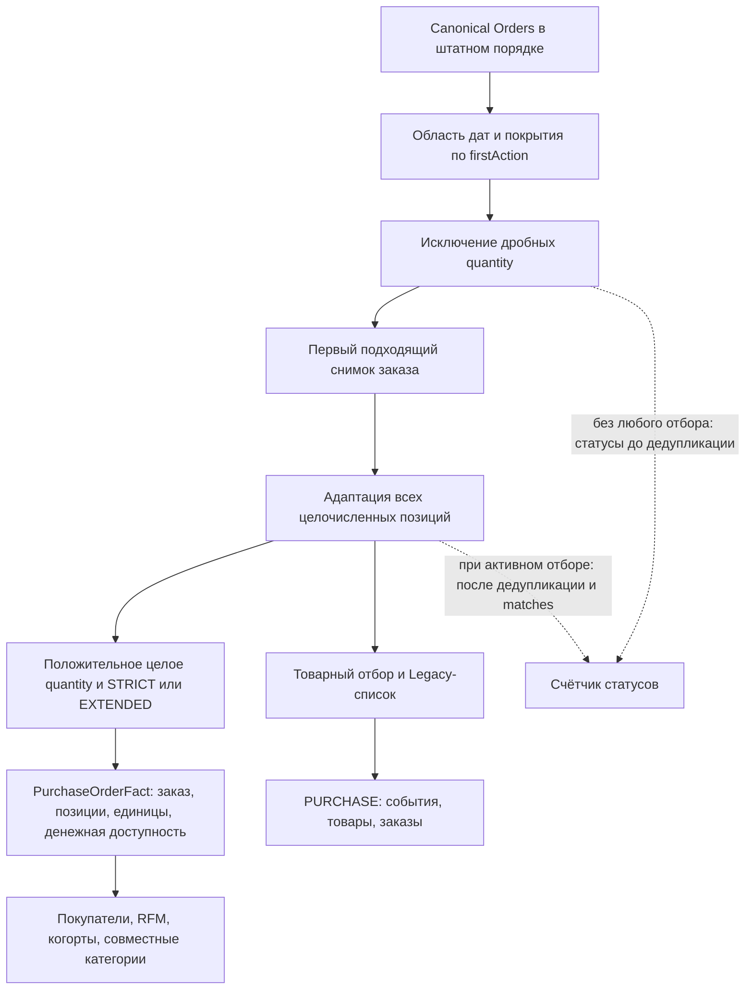

# STAT-STATUS-AUDIT-01 — аудит статусов Mindbox и модели покупок

Дата аудита: 06.11.2026. Проект `D:/RecommendationSystem`, ветка `feature/hybrid-ranking`, HEAD `2b56bb8fb7fa44fb2987407b0bb98fc3b7d6f3a5`. **AUDIT ONLY**: изменены только этот документ и CSV-инвентарь; реализация, источники, кеш и индексы сохранены.

## 1. Executive summary

- **42 статуса** имеют подтверждённые пользователем название, точный externalId и категорию; **43 кода** известны программе. В готовом счётчике найдено **20 кодов**, включая дополнительный `Mindbox-Tech-Cancellation`. Наличие полного актуального справочника самого кабинета Mindbox не доказано. Для 23 кодов, не встреченных в счётчике, глобальная встречаемость оставлена неизвестной.
- Три действующие политики различаются: Legacy `CP, delivering, F`, STRICT `F, sold`, EXTENDED `F, sold, CP`. Это влияет и на покупателей, и на рекомендации. Одного изменения списка в одном модуле недостаточно.
- **CP сейчас включает всю пригодную `priceOfLine` в Legacy/EXTENDED**, но доступные поля не доказывают, какая часть количества и суммы реально выкуплена. Возвратный статус не является подтверждением возвращённого платежа. Чистую выручку по этим полям считать нельзя.
- Расчёт выбирает первый подходящий снимок; 1 553 конфликтующих повтора в сохранённом срезе не заменяют его. INDEXED 3 хранит все проецированные вхождения снимков, но теряет исходную идентичность позиции и часть денежных полей. **Полной истории переходов в статистическом контракте нет.** Вместе с тем в raw Actions обнаружены события изменения статуса с вложенным заказом — это реальный кандидат для будущей событийной модели, а не доказательство её готовности.
- Рекомендация: одна явно версионированная бизнес-политика с раздельными фактами покупки, отмены, возвратного состояния и подтверждённого денежного возврата; неопределённость CP сохранять. Событийную историю подключать только после проверки полноты, часов и идентичностей. Ни новый контракт, ни миграция здесь не реализованы.

### Источники и границы доказательности

**U1:** текстовый справочник из 42 троек, предоставленный Иваном ранее в этом чате в ответе к STAT-ORDER-STATUS-DIAGNOSTICS-01. Текущие скриншоты/экспорт кабинета в этой задаче не представлены. Это подтверждение справочника пользователя, а не свежая выгрузка всех настроек Mindbox.

**C:** актуальные локальные исходники; ссылки ниже ведут к функциям и проверенным строкам. **D1:** `user_settings/dataset_statistics.json`, schema 10, рассчитан 05.11.2026 в 13:18:47 UTC, без отбора. Объявленное покрытие Actions/Orders: `[2022-01-01, 2026-09-01)` UTC. Кеш прошёл действующий `validate_result()`; это внутренняя согласованность, а не независимая проверка бизнес-смысла.

**I1:** текущий INDEXED schema 3, поколение `c0fe5398e5b44c97a50f684a59d410d0`, `index_state() == READY`. Manifest и встроенная metadata совпали; прочитаны только схема и метаданные через SQLite `mode=ro&immutable=1`. Manifest содержит 1 365 775 вхождений заказов и 2 990 437 строк позиций. Запрос GROUP BY статуса по plan потребовал бы полного сканирования; он **не выполнялся**.

**P1:** ограниченная структурная проба: первые 64 заказа каждой из шести частей canonical (5 MANUAL + 1 API), всего **384 заказа / 813 позиций**, около 1,6 MiB прочитано. **P2:** префикс API Actions, 615 действий / 1 MiB, до первых восьми событий изменения статуса; вложенных позиций в них 22. Пробы не случайные, не являются полной статистикой и не доказывают отсутствия полей или статусов во всех данных. Все отчётные результаты агрегированы, без исходных идентификаторов клиентов и заказов, контактов и содержимого отдельных заказов.

Маркировка в документе: **Факт** — непосредственно проверенный код/счётчик/структура; **Вывод** — следствие проверенного кода; **Гипотеза** — требует дополнительного подтверждения; **Рекомендация** — будущий проект, не изменение текущей системы.

Исследовательские записи: [D1 и границы счётчика](D:/CodexTestTemp/statistics-status-audit01-1793965607837059600/cached-status-evidence.json); [I1: схема и EXPLAIN](D:/CodexTestTemp/statistics-status-audit01-1793965607837059600/index-schema-evidence.json); [I1: manifest](D:/CodexTestTemp/statistics-status-audit01-1793965607837059600/index-manifest-evidence.json); [P1](D:/CodexTestTemp/statistics-status-audit01-1793965607837059600/raw-shape-evidence.json); [P2](D:/CodexTestTemp/statistics-status-audit01-1793965607837059600/action-shape-evidence.json); [синтетические сценарии](D:/CodexTestTemp/statistics-status-audit01-1793965607837059600/synthetic-rules-evidence.json). Исполнявшиеся ограниченные проверки: [probe_raw_shapes.py](D:/CodexTestTemp/statistics-status-audit01-1793965607837059600/probe_raw_shapes.py), [probe_action_shapes.py](D:/CodexTestTemp/statistics-status-audit01-1793965607837059600/probe_action_shapes.py), [probe_synthetic_rules.py](D:/CodexTestTemp/statistics-status-audit01-1793965607837059600/probe_synthetic_rules.py).

## 2. Текущая модель учёта покупок

**Факт.** Источник правил Legacy — сохранённая canonical selection, а не обязательное применение сегодняшнего значения константы. Дефолт и manifest текущего индекса совпадают: `CP/delivering/F`. [mindbox/selection.py:19](D:/RecommendationSystem/Application/mindbox/selection.py:19); [dataset_statistics.py:_calculate_statistics](D:/RecommendationSystem/Application/dataset_statistics.py:460). Аналитические списки определены отдельно: [statistics_purchase_policy.py:eligible_purchase_policies](D:/RecommendationSystem/Application/statistics_purchase_policy.py:82), [statistics_purchase_policy.py:accepts_purchase_line](D:/RecommendationSystem/Application/statistics_purchase_policy.py:94).

| Правило | Статусы покупки | Количество | Заказ / покупатель | Деньги |
|---|---|---|---|---|
| Legacy товарного среза | CP, delivering, F | Драйвер исключает дробные quantity; builder сам не проверяет положительность. Ноль может создать PURCHASE; отрицательное количество принятой покупки затем отклоняет денежный агрегатор | Хотя бы одна принятая позиция; уникальный заказ выбранного снимка; канонический клиент | Сумма принятых priceOfLine, отдельно RUB/KZT; не весь totalPrice |
| STRICT_COMPLETED | F, sold | Конечное положительное целое; bool, строки, дробные, ноль, отрицательные отвергнуты | has_purchase = line_count > 0; заказ один раз, покупатель по canonical identity | Сумма пригодных принятых позиций; цена не определяет наличие покупки |
| EXTENDED_COMPLETED | F, sold, CP | Та же проверка | Тот же выбранный снимок и гранулярность | Добавляет принятую CP-позицию целиком, без доказательства фактического частичного выкупа |

Статусная группа и принадлежность политике — разные проверки: `classify_status()` классифицирует даже неподходящее quantity; `eligible_purchase_policies()` проверяет статус и quantity. Неизвестная политика вызывает ValueError. [statistics_purchase_policy.py:classify_status](D:/RecommendationSystem/Application/statistics_purchase_policy.py:68); [statistics_purchase_facts.py:build_purchase_order_fact](D:/RecommendationSystem/Application/statistics_purchase_facts.py:95).

Это схема зависимостей, а не буквальный порядок одного общего селектора: покупательская база, RFM и когорты имеют **собственные области** и свои множества первых заказов; один уже подготовленный факт переиспользуется. Не нужно считать, что все разделы обязательно выбрали один и тот же снимок при разных датах/покрытии. [dataset_statistics.py:_calculate_statistics.purchase_fact](D:/RecommendationSystem/Application/dataset_statistics.py:580); [dataset_statistics.py:_calculate_statistics](D:/RecommendationSystem/Application/dataset_statistics.py:577); [dataset_statistics.py:_calculate_statistics](D:/RecommendationSystem/Application/dataset_statistics.py:612).

### Гранулярность действующих показателей

| Показатель | Единица и текущая граница |
|---|---|
| orders / order_lines | Без отбора — вхождения raw-снимков и их целочисленные позиции до дедупликации; при active=True — business_orders/business_lines выбранных снимков после отбора |
| purchase_orders | Уникальные выбранные заказы с хотя бы одной Legacy-позицией |
| orders_without_purchase | business_orders минус purchase_orders; не разность сырых orders и покупок, не специальная метрика отмен |
| purchase_interactions / policy.positions | Принятые позиции, не количество товаров в них |
| purchase_quantity / policy.units | Сумма принятой quantity, с разными gate каждого тракта |
| purchase_users / policy.buyers | Уникальные канонические клиенты своей области/политики |
| repeat_buyers | Клиенты с минимум двумя принятыми уникальными заказами своей области/политики |
| Денежные суммы | Принятые priceOfLine при пригодной валюте/цене; не весь заказ, не единицы × цена линии |
| Отмены/возвраты | Классифицированные позиции выбранного состояния; отдельный подтверждённый финансовый поток отсутствует |

Источники: [dataset_statistics.py:_calculate_statistics](D:/RecommendationSystem/Application/dataset_statistics.py:760); [dataset_statistics.py:_calculate_statistics](D:/RecommendationSystem/Application/dataset_statistics.py:792); [statistics_purchase_facts.py:PurchasePolicyResult.has_purchase](D:/RecommendationSystem/Application/statistics_purchase_facts.py:36); [statistics_buyer_aggregates.py:BuyerAggregates.add](D:/RecommendationSystem/Application/statistics_buyer_aggregates.py:302).

### Наблюдаемые различия готового результата

Это сохранённые результаты, не новый расчёт и не прогноз эффекта будущей реформы. В таблице нельзя смешивать разделы или складывать политики. Источник: [ready-policy-counts.json](D:/CodexTestTemp/statistics-status-audit01-1793965607837059600/ready-policy-counts.json).

| Модель | Покупатели | Заказы с покупкой | Принятые позиции | Повторные покупатели |
|---|---:|---:|---:|---:|
| Legacy | 500 031 | 1 222 544 | 2 724 443 | 217 427 |
| STRICT | 499 111 | 1 212 391 | 2 697 998 | 216 428 |
| EXTENDED | 499 994 | 1 221 980 | 2 723 074 | 217 340 |

STRICT/EXTENDED здесь имеют общую покупательскую область, а Legacy по архитектуре может дополнительно отличаться пересечением покрытий и товарным отбором. Эти основания нужно сохранять даже когда даты текущего результата совпадают.

## 3. Проверенный справочник статусов и пробелы

**Факт U1:** 18 «Оформлена», 7 «Оплачена», 7 «Доставлена», 3 «Возврат», 7 «Отменена» — всего 42. Названия U1 согласуются с [statistics_presentation.py:59](D:/RecommendationSystem/Application/statistics_presentation.py:59). Код групп знает дополнительно техническую отмену. Программный UI-ярлык «Техническая отмена» не подменяет неизвестные официальные имя/категорию Mindbox.

Полный машиночитаемый каталог: [statistics_status_inventory.csv](D:/RecommendationSystem/docs/statistics_status_inventory.csv). UTF-8 BOM, CSV с запятой, 43 строки. В CSV перечислены точный ID, название, категория, состояние проверки, число вхождений в готовом срезе, группа, три флага, источники и ограничения. Пустое count означает неизвестность; измеренных нулей здесь нет.

Ниже числа означают **вхождения целочисленных позиций в снимках до дедупликации** текущего неотфильтрованного кеша, а не уникальные проданные позиции и не полный raw за всё время. «н/п» — полный набор не проверен; в готовом счётчике код отсутствует. Метаданные каждой обычной строки подтверждены U1; технической строки — только C и D1. Флаги покупки относятся только к статусу; quantity/дата/снимок/цена проверяются отдельно.

| Название | External ID | Категория U1 | Вхождений D1 | Группа C | Legacy | STRICT | EXTENDED |
|---|---|---|---|---|---|---|---|
| Официальное имя не подтверждено | `Mindbox-Tech-Cancellation` | Не подтверждена | 24975 | CANCELLED | Нет | Нет | Нет |
| Возврат | `Return` | Возврат | 61542 | RETURNED | Нет | Нет | Нет |
| Клиентский возврат | `klientskii-vozvrat` | Возврат | 4448 | RETURNED | Нет | Нет | Нет |
| Курьерский возврат | `kurerskii-vozvrat` | Возврат | 45 | RETURNED | Нет | Нет | Нет |
| Выполнен частично | `CP` | Доставлена | 25624 | PARTIALLY_COMPLETED | Да | Нет | Да |
| Выполнен | `F` | Доставлена | 2700108 | COMPLETED | Да | Да | Да |
| Прибыл в ПВЗ | `arrived-in-pickup-point` | Доставлена | н/п | DELIVERY_IN_PROGRESS | Нет | Нет | Нет |
| Доставка по графику | `de` | Доставлена | н/п | DELIVERY_IN_PROGRESS | Нет | Нет | Нет |
| Готов к самовывозу | `ready-for-self-pickup` | Доставлена | н/п | DELIVERY_IN_PROGRESS | Нет | Нет | Нет |
| Передан в доставку | `send-to-delivery` | Доставлена | н/п | DELIVERY_IN_PROGRESS | Нет | Нет | Нет |
| Продан | `sold` | Доставлена | 882 | COMPLETED | Нет | Да | Да |
| Укомплектован | `assembling-complete` | Оплачена | н/п | PAID_OR_IN_PROGRESS | Нет | Нет | Нет |
| Доставляется | `delivering` | Оплачена | 2281 | PAID_OR_IN_PROGRESS | Да | Нет | Нет |
| Готов к отправке (crm) | `gotov-otpravka` | Оплачена | 272 | PAID_OR_IN_PROGRESS | Нет | Нет | Нет |
| Предоплата поступила | `prepayed` | Оплачена | н/п | PAID_OR_IN_PROGRESS | Нет | Нет | Нет |
| Доставка перенесена | `redirect` | Оплачена | н/п | PAID_OR_IN_PROGRESS | Нет | Нет | Нет |
| Передано в комплектацию | `send-to-assembling` | Оплачена | н/п | PAID_OR_IN_PROGRESS | Нет | Нет | Нет |
| Оплачен | `Оплачен` | Оплачена | 4264 | PAID_OR_IN_PROGRESS | Нет | Нет | Нет |
| Отменен | `CD` | Отменена | 73120 | CANCELLED | Нет | Нет | Нет |
| Отказ | `RJ` | Отменена | 2 | CANCELLED | Нет | Нет | Нет |
| Купил в другом месте | `already-buyed` | Отменена | н/п | CANCELLED | Нет | Нет | Нет |
| Не устроила доставка | `delyvery-did-not-suit` | Отменена | н/п | CANCELLED | Нет | Нет | Нет |
| Нет в наличии (crm) | `no-product` | Отменена | 13873 | CANCELLED | Нет | Нет | Нет |
| Отменён | `otmenen` | Отменена | 895 | CANCELLED | Нет | Нет | Нет |
| Нет в наличии | `out-of-stock` | Отменена | 3344 | CANCELLED | Нет | Нет | Нет |
| Комплектация заказа | `DA` | Оформлена | н/п | ORDER_IN_PROGRESS | Нет | Нет | Нет |
| Готов к отправке | `DB` | Оформлена | н/п | ORDER_IN_PROGRESS | Нет | Нет | Нет |
| Комплектация заказа (некомплект) | `DD` | Оформлена | н/п | ORDER_IN_PROGRESS | Нет | Нет | Нет |
| Заказ отправлен | `DG` | Оформлена | н/п | ORDER_IN_PROGRESS | Нет | Нет | Нет |
| Доставлен в пункт самовывоза | `DS` | Оформлена | 918 | ORDER_IN_PROGRESS | Нет | Нет | Нет |
| Принят | `N` | Оформлена | 69632 | ORDER_IN_PROGRESS | Нет | Нет | Нет |
| Комплектуется | `assembling` | Оформлена | н/п | ORDER_IN_PROGRESS | Нет | Нет | Нет |
| Наличие подтверждено | `availability-confirmed` | Оформлена | н/п | ORDER_IN_PROGRESS | Нет | Нет | Нет |
| Согласовано с клиентом | `client-confirmed` | Оформлена | н/п | ORDER_IN_PROGRESS | Нет | Нет | Нет |
| К выполнению | `kv` | Оформлена | 13 | ORDER_IN_PROGRESS | Нет | Нет | Нет |
| Новый | `new` | Оформлена | 17 | ORDER_IN_PROGRESS | Нет | Нет | Нет |
| Недозвон | `no-call` | Оформлена | н/п | ORDER_IN_PROGRESS | Нет | Нет | Нет |
| Предложить замену | `offer-analog` | Оформлена | н/п | ORDER_IN_PROGRESS | Нет | Нет | Нет |
| Оприходовать перемещения | `opr-perem` | Оформлена | н/п | ORDER_IN_PROGRESS | Нет | Нет | Нет |
| Готов ждать | `ready-to-wait` | Оформлена | н/п | ORDER_IN_PROGRESS | Нет | Нет | Нет |
| Собран в магазине | `sh` | Оформлена | н/п | ORDER_IN_PROGRESS | Нет | Нет | Нет |
| Согласование | `soglasovanie` | Оформлена | н/п | ORDER_IN_PROGRESS | Нет | Нет | Нет |
| Товар найден | `tovar-naiden` | Оформлена | 350 | ORDER_IN_PROGRESS | Нет | Нет | Нет |

**Вне подтверждённого каталога:** `Mindbox-Tech-Cancellation`, 24 975 вхождений D1. Среди прочих 19 кодов D1 нет неизвестного `classify_status()` кода. Это не доказательство, что других кодов нет вне рассматриваемого среза. Нет официального полного tenant-export справочника, версии и даты его вступления в силу — эти пробелы нужно закрыть перед утверждением нового нормативного списка.

## 4. Статусы, политики и точность идентификаторов

В категоризацию «Доставлена» входят CP/F/sold и также send-to-delivery/ready-for-self-pickup/arrived-in-pickup-point/de. Последние четыре программа не признаёт завершённой покупкой. Метаданные категории нельзя автоматически превратить в признание выкупа. [statistics_purchase_policy.py:15](D:/RecommendationSystem/Application/statistics_purchase_policy.py:15).

`classify_status()` сравнивает точные строки с учётом регистра. Raw `identifier()` отклоняет краевые пробелы, не удаляет их. `F`, `f`, `Return`, `return`, `CD`, `otmenen`, `Оплачен` остаются разными значениями. В исследовании регистр/написание не исправлялись; raw-пробы требуют строкового ID. Настройки selection отдельно strip-ят пользовательские значения, а старый CSV-процессор strip-ит колонку статуса: это **другой путь**, а не единая нормализация raw. [mindbox/adapters/_common.py:42](D:/RecommendationSystem/Application/mindbox/adapters/_common.py:42); [mindbox/selection.py:47](D:/RecommendationSystem/Application/mindbox/selection.py:47); [files/files_processing.py:132](D:/RecommendationSystem/Application/files/files_processing.py:132).

### Область и стадия счётчика статусов

| Отбор AnalysisFilter | Момент учёта статуса |
|---|---|
| Все поля null, active=False | После проверки дат/целочисленности, **до** OrderSnapshots.accept |
| Только явные даты, даже без товарного отбора | active=True: **после** выбора снимка и адаптации |
| Вид номенклатуры / коллекция, с датами или без | После выбора снимка, адаптации и matches(product) |

Важен **любой активный отбор**, а не только товарный. При одинаковых фактических датах включение явного диапазона может изменить стадию подсчёта. [analysis_filter.py:39](D:/RecommendationSystem/Application/analysis_filter.py:39); [dataset_statistics.py:_calculate_statistics](D:/RecommendationSystem/Application/dataset_statistics.py:661); [dataset_statistics.py:_calculate_statistics](D:/RecommendationSystem/Application/dataset_statistics.py:677).

D1 содержит 1 363 094 вхождения заказов в общем периоде, 1 357 181 уникальный выбранный заказ, 4 360 идентичных и 1 553 конфликтующих повторов. Сумма 20 статусных счётчиков — 2 986 605; unique_order_lines — 2 975 786. Отдельно исключены 2 681 заказ вне общего периода и одна дробная позиция. Поэтому отсутствующий код не объявлен глобальным нулём. Сохранённый buyer.return_positions = 63 226 — отдельный счётчик возвращённых позиций выбранных фактов; сумма трёх raw-статусов возврата D1 = 66 035. Разность не следует интерпретировать как денежный возврат или автоматически приписывать одной причине.

Для полного будущего каталога нужен один заранее определённый scope/стадия, отдельные raw/selected/invalid счётчики и полнота источника. Здесь полного SQL/raw-пересчёта не было.

## 5. Структура исходных заказов и позиций

Основной адаптер: [mindbox/adapters/orders.py:adapt_order](D:/RecommendationSystem/Application/mindbox/adapters/orders.py:19); тип записи: [mindbox/records.py:47](D:/RecommendationSystem/Application/mindbox/records.py:47). P1 подтверждает следующий срез полей; количества в этой таблице относятся **только к пробе**.

| Поле raw | Наблюдение P1 | Текущее назначение |
|---|---|---|
| ids.mindboxId | 384/384 | Ключ заказа; в адаптере строковый identifier |
| ids.retailOrderId | 362/384 | Дополнительный ID; необязательный |
| firstAction.dateTimeUtc | 384/384 | Дата оформления/первого действия, текущая дата аналитического учёта |
| firstAction.channel | 384/384 | Канал/магазин первого действия |
| totalPrice | 384/384 | Цена заказа; читается адаптером, не является источником суммы политики |
| deliveryCost | 56/384 | Отдельная стоимость доставки; не добавляется к сумме принятых позиций |
| lines[].id | 807/813 | Идентичность позиции; для отсутствующего id адаптер синтезирует локальный ID |
| lines[].number | 813/813 | Порядковый номер позиции, должен быть int |
| quantity / priceOfLine / basePricePerItem | 813/813 | Decimal; наличие числа не доказывает смысл фактического выкупа |
| lines[].status.ids.externalId | 813/813 | Единственный используемый статус; статус позиции |
| payments[].amount/id/type | 175 платежных элементов в 155 заказах | Суммы/ID присутствуют в raw, но типовой статистический тракт использует только type |
| transaction.ids.externalId | 51/384 | Есть внешний ID транзакции; его связь с исходной продажей/возвратом не установлена |
| lines[].customFields.discountAmount | 726/813 | Скидочное поле; сейчас не используется для расчёта признанной продажи |

**Не обнаружены в P1:** отдельный статус целого заказа, timestamp изменения позиции/заказа, массив истории статусов, fulfilledQuantity/returnedQuantity, returnedPayments, явный ID исходной продажи для возврата. Это **не проверка отсутствия во всех raw**. Адаптер этих полей не читает независимо от результата пробы. Отрицательные quantity/price/basePrice/totalPrice/payment.amount в пробе не встретились; это не глобальный ноль и не доказательство невозможности отрицательных данных.

### События изменения статуса в Actions

D1 содержит шаблоны `IzmenenieStatusaZakazaVOperaciiOffline` (592) и `IzmenenieStatusaZakazaVOperacii` (144). В P2 найдены восемь таких действий с `ids.mindboxId`, `dateTimeUtc`, `creationDateTimeUtc`, `order.ids`, `order.lines[].id/number/quantity/priceOfLine/status`; вложенные статусы F/CD. Идентификаторы/значения заказов не выгружались. Это **подтверждённая доступность структуры для части событий**, но не доказательство полного жизненного цикла за 2022–2026 годы или того, что вложенный order является неизменяемым состоянием ровно на дату события.

Действующий адаптер Actions не переносит вложенный order. Шаблоны вне VIEW/FAVORITE идут в unmapped; Projector сохраняет их имя/дату/канонический клиентский SID, но не связь с заказом, позиции или creationDateTimeUtc. [mindbox/adapters/actions.py:adapt_action](D:/RecommendationSystem/Application/mindbox/adapters/actions.py:17); [statistics_facts.py:Projector.action](D:/RecommendationSystem/Application/statistics_facts.py:94); [dataset_statistics.py:_calculate_statistics](D:/RecommendationSystem/Application/dataset_statistics.py:549).

### Что уточняет официальная документация

[Экспорт заказов Mindbox](https://developers.mindbox.ru/docs/export-orders-and-lines) описывает отбор по изменениям, тогда как firstAction — время оформления. **Вывод/риск:** интервал экспорта нельзя без проверки считать полным покрытием заказов по дате оформления. Текущий код использует метаданные since/until именно как покрытие firstAction. Это требует сверки tenant-настройки операции и происхождения ручной исторической базы; неверная полнота текущего периода не установлена одним только сравнением контрактов.

[Экспорт действий](https://developers.mindbox.ru/docs/export-customer-actions) различает время совершения и создания действия в системе, а отбор экспорта привязан к созданию; связанный заказ может включаться настройкой. В P2 оба времени оказались внутри интервала части, но эта малая проба не исключает поздние/задние действия в других записях. Для будущей истории нужны оба времени и проверка полноты. Полноценный ас-of нельзя получить подменой одного времени другим.

## 6. Снимки и дедупликация

[mindbox/order_dedup.py:OrderSnapshots.accept](D:/RecommendationSystem/Application/mindbox/order_dedup.py:56) и [mindbox/order_dedup.py:semantic_fingerprint](D:/RecommendationSystem/Application/mindbox/order_dedup.py:14): ключ — ids.mindboxId, fingerprint — **весь raw JSON**. Порядок ключей dict не важен; числовые формы канонизируются; порядок массивов и различие строк/чисел сохраняются. Изменение не только статуса, но и иных полей способно дать конфликт. Счётчик конфликтов сам по себе не говорит, какие поля поменялись.

При diagnose=True принимается первый встретившийся подходящий снимок; идентичные и конфликтующие повторы пропускаются с диагностикой. По умолчанию REFERENCE OrderSnapshots выбрасывает OrderSnapshotConflict на конфликте. INDEXED-драйвер в штатном расчёте использует свои заранее сохранённые fingerprints и то же первое подходящее вхождение. [statistics_facts.py:IndexedSnapshots.accept](D:/RecommendationSystem/Application/statistics_facts.py:214); [statistics_query.py:IndexedInput.records](D:/RecommendationSystem/Application/statistics_query.py:94).

Источники упорядочены effective_entries по since, приоритет MANUAL исключает пересекающиеся API-интервалы; затем части и записи идут штатным порядком. Порядок источников не является временем изменения статуса. [mindbox/canonical_storage.py:effective_entries](D:/RecommendationSystem/Application/mindbox/canonical_storage.py:119); [mindbox/raw_reader.py:129](D:/RecommendationSystem/Application/mindbox/raw_reader.py:129).

Проверено синтетически, **не описание фактической последовательности конкретного заказа Mindbox**:

| Последовательность снимков в источнике | Выбранное состояние | Результат |
|---|---|---|
| new → Оплачен → F → Return | new | Три конфликта; последующая покупка/возврат не становятся отдельными фактами |
| Return → F | Return | Поздний F не восстанавливает покупку |
| F → Return | F | Возврат не уменьшает покупку и не создаёт денежный расход |

Когорты и RFM отслеживают первый заказ в своих областях независимо от Legacy; их множества не хранят все fingerprints/счётчики конфликтов. История по нескольким политикам использует один подготовленный факт. Детальный экспорт тоже выбирает первый снимок до проверки покупочной политики, диагностирует конфликты и отдельно отклоняет расхождение scope. Область экспорта — история Orders до cutoff, поэтому нельзя обещать равенство выбора с Legacy-пересечением при любых границах. [dataset_statistics.py:_calculate_statistics](D:/RecommendationSystem/Application/dataset_statistics.py:577); [statistics_detail_backend.py:_ingest](D:/RecommendationSystem/Application/statistics_detail_backend.py:195).

**INDEXED 3 не удаляет повторы заказов при построении:** Projector.order вызывается для каждого raw-вхождения. В БД остаются order_sid/fingerprint/проекции строк всех таких вхождений. Но исходные ID позиций, полная raw-структура и время изменения не сохраняются. Fingerprint не позволяет восстановить потерянное содержимое. [statistics_index.py:318](D:/RecommendationSystem/Application/statistics_index.py:318); [statistics_facts.py:Projector.order](D:/RecommendationSystem/Application/statistics_facts.py:122).

Отдельный customer_history_index хранит варианты/исходную идентичность позиций для клиентской истории; это **другой индекс и другой контракт**, не статистический INDEXED 3. Он тоже не превращает firstAction в timestamp изменения статуса. [customer_history_index.py:256](D:/RecommendationSystem/Application/customer_history_index.py:256); [customer_history_normalization.py:26](D:/RecommendationSystem/Application/customer_history_normalization.py:26).

## 7. Частично выполненные покупки и гранулярность

Одна принятая позиция — одна строка, единицы — quantity, заказ с несколькими подходящими позициями — один заказ, покупатель — canonical ID. Денежный amount — сумма принятых **priceOfLine**, без умножения на quantity и без доставки. Подтверждение цены всей позиции также есть в [официальном контракте экспорта](https://developers.mindbox.ru/docs/export-orders-and-lines); семантика фактически выкупленной части CP из него не следует. [statistics_purchase_facts.py:_Totals.add](D:/RecommendationSystem/Application/statistics_purchase_facts.py:67); [order_statistics.py:OrderAggregates.add](D:/RecommendationSystem/Application/order_statistics.py:112).

Синтетические A–H: по одной единице в позиции, суммы 10 и 20 RUB, один выбранный заказ. «Число позиций» ниже — принятые программой позиции; не физически подтверждённый выкуп.

| Случай | Статусы | Legacy / STRICT / EXTENDED: принятых позиций | Что происходит |
|---|---|---|---|
| A. Всё выполнено | F + sold | 1 / 2 / 2 | Один заказ во всех политиках; Legacy теряет sold |
| B. Выполнено и отменено | F + CD | 1 / 1 / 1 | Покупка только F; отмена не вычитается из суммы |
| C. Выполнено и возвращено | F + Return | 1 / 1 / 1 | Возвратная строка классифицирована отдельно, net-суммы нет |
| D. Всё отменено | CD + RJ | 0 / 0 / 0 | Нет покупочного заказа; общий заказ/статусы остаются |
| E. Всё возвращено | Return + клиентский возврат | 0 / 0 / 0 | Из одного такого снимка историческая продажа не восстанавливается |
| F. Разные стадии | N + delivering | 1 / 0 / 0 | Legacy создаёт покупку на доставке |
| G. Частичное выполнение | CP | 1 / 0 / 1 | Legacy/EXTENDED включают всю пригодную сумму позиции |
| H. Неизвестный статус | unknown-synthetic | 0 / 0 / 0 | UNKNOWN, не покупка; неизвестный код не должен теряться из статусов |

F+CP технически допустимы в одном заказе; синтетически дают 2/1/2 принятых позиции и один заказ на политику. В ограниченной P1 **не найдено доказательства фактического F+CP**, зато найдены 11 CP-позиций в четырёх снимках, включая один CP+klientskii-vozvrat. Это доказывает смешанное состояние, но не распределение выполненного количества внутри CP.

Для CP не установлены: выкупленное/отменённое количество, доля priceOfLine, момент выполнения, связь разделившихся позиций. Наличие quantity/price само по себе этого не доказывает. Без контракта интеграции безопасно признавать лишь наблюдаемое частичное состояние; для единой поведенческой покупки CP нужен явный бизнес-договор. Сумму CP можно показывать как **наблюдаемую сумму позиции с неопределённым выкупом**, сохраняя неизвестную признанную сумму. Не назначать ей автоматически долю 50%, quantity-коэффициент или полную M.

Дополнительная граница количества: при quantity=0 Legacy builder выдаёт PURCHASE и OrderAggregates может учесть priceOfLine; STRICT/EXTENDED отвергают его. При -1 Legacy денежный агрегатор падает AdapterError. Builder отдельно допускает 1.5, но штатный статистический драйвер такую позицию исключает заранее; нельзя переносить результат изолированного builder на полный pipeline. Это синтетическое подтверждение правил, не утверждение об обнаруженных ошибочных raw. [synthetic-rules-evidence.json](D:/CodexTestTemp/statistics-status-audit01-1793965607837059600/synthetic-rules-evidence.json).

## 8. Отмены

Программа классифицирует CD/RJ/otmenen/no-product/out-of-stock/already-buyed/delyvery-did-not-suit/техническую отмену в CANCELLED. В D1 встречаются шесть из этих кодов, сумма их raw-вхождений 116 209. Это не число отменённых уникальных заказов.

| Показатель | Что доступно сейчас | Ограничение |
|---|---|---|
| Отменённые позиции/причины | Код и группа позиции; возможен счёт по выбранным снимкам | Текущий D1 pre-dedup; причины — ярлыки статусов, не обязательно отдельная причина отмены |
| Заказы с отменой / полностью отменённые / смешанные | Можно вывести из выбранного снимка при полном наборе его строк | Отдельных надёжных агрегатов в обычном DTO нет; здесь не рассчитывались |
| Покупатели с отменой | Canonical ID доступен в REF и SID в INDEXED | Не новая покупательская метрика текущего DTO; нужен определённый scope |
| Сумма отменённых строк | При известных валюте/цене можно получить наблюдаемый номинал | Это не возвращённый платёж и не финансовая потеря |
| До покупки или после частичного выполнения | Полный порядок переходов не доказан | Один статус и дата оформления не разрешают вопрос |

Заказ с F+CD не становится целиком отменённым. Полностью отменённым в **состояниях выбранного снимка** можно назвать только заказ, все его учитываемые позиции которого однозначно отменены; пустой/повреждённый/неполный снимок требует UNKNOWN. Смешанное/частично отменённое состояние должно пересекаться с признаком покупки, а не исключать его автоматически. Это рекомендация классификатора состояний, не реконструкция отменённых операций.

## 9. Возвраты

Return/klientskii-vozvrat/kurerskii-vozvrat исключены из всех трёх покупочных списков; classify_status и PurchaseOrderFact считают возвратные строки, **не денежные операции**. BuyerAggregates собирает return_positions до отбора has_purchase. Детальная проекция содержит returned/cancelled line counts и оба покупочных признака, но не возвращённый платёж. [statistics_purchase_facts.py:PurchaseOrderFact.return_line_count](D:/RecommendationSystem/Application/statistics_purchase_facts.py:55); [statistics_buyer_aggregates.py:BuyerAggregates.add](D:/RecommendationSystem/Application/statistics_buyer_aggregates.py:302); [statistics_detail_projection.py:project_order](D:/RecommendationSystem/Application/statistics_detail_projection.py:198).

В деталях other_lines = все строки минус возвращённые и отменённые; это не число непокупочных позиций: туда входят и выполненные.

Что подтверждено: в P1 25 Return и 5 клиентских возвратных позиций; шесть снимков содержат F+Return, один — CP+клиентский возврат. Что не установлено: были ли возвраты отдельным документом, прежним состоянием той же строки или результатом её разделения; фактические возвращённые единицы/суммы, refund ID, дата возврата, повторный частичный возврат и исходная финансовая продажа.

[Изменение статуса позиции Mindbox](https://developers.mindbox.ru/docs/update-order-line-status) допускает обновление всех/отдельных позиций и их разделение при частичном возврате; денежный возврат передаётся отдельным returnedPayments. Это **возможности API**, не подтверждение, что tenant передаёт такие поля и что они доступны в имеющемся экспорте. `transaction.ids.externalId` без контракта нельзя принять за ID исходной продажи; `customerBalanceChanges` описывает бонусные изменения, не банковский возврат.

Повторяющиеся экспортные возвратные состояния нельзя суммировать как повторные refund-операции. Для идемпотентности будущих событий нужны идентичность операции и связь с исходной продажей/позицией, а при разделении строки — подтверждённые правила сопоставления. Снимок только Return не доказывает ни отсутствие исторической покупки, ни её дату. Снимок F, выбранный раньше Return, сохраняет покупку без вычета.

## 10. Денежная достоверность

| Желаемый показатель | Оценка доступности | Безопасное толкование |
|---|---|---|
| Сумма принятых F/sold | Доступна при пригодной цене и однозначной валюте | Сумма позиций по статусу; не банковское поступление |
| CP | Номинальная priceOfLine есть, подтверждённая выкупленная часть не установлена | Отдельная известная исходная сумма и неизвестная признанная сумма |
| Отменённые позиции | Номинал строки можно оценить условно | Не сумма возвращённых денег |
| Возвратные позиции | Номинал строки можно оценить условно | Не подтверждённый refund |
| Покупки минус возвраты / доля возврата в деньгах | Надёжно не установлены | Нужны сопоставимые продажи/refunds, валюты, время и идемпотентность |

В текущем PurchasePolicyResult: UNKNOWN_CURRENCY/MIXED_CURRENCY/INVALID_PRICE делают Monetary недоступной, сохраняя has_purchase. Нулевая пригодная цена равна достоверному нулю. Цена не умножается на quantity. Отрицательная цена в изолированном fact даёт INVALID_PRICE, однако исходная отсутствующая/нечисловая priceOfLine может остановить адаптер раньше; не следует обещать, что любой плохой raw автоматически сохранит F/R. Legacy OrderAggregates отклоняет отрицательную цену. [statistics_purchase_facts.py:_Totals.result](D:/RecommendationSystem/Application/statistics_purchase_facts.py:77); [statistics_purchase_facts.py:build_purchase_order_fact](D:/RecommendationSystem/Application/statistics_purchase_facts.py:95); [mindbox/adapters/_common.py:88](D:/RecommendationSystem/Application/mindbox/adapters/_common.py:88); [order_statistics.py:_decimal](D:/RecommendationSystem/Application/order_statistics.py:16).

RUB/KZT задаются namespace offline1C/kanzlerKz, это соглашение источника. Цена позиции, totalPrice, payments.amount, бонусные списания и returnedPayments — разные величины. Не подменять одну другой и не называть разность неподтверждённых номиналов чистой выручкой или LTV.

## 11. Доступность данных в INDEXED schema 3

Проверены реальная DDL и manifest. Projector сохраняет каждое вхождение заказа; orders.id — raw ordinal. order_sid/customer SID заменяют исходные ID; таблицы соответствия удаляются перед публикацией, для когорт остаётся rank исходного order ID. order_lines.ordinal — позиция в массиве, **не исходный line.id или line.number**. [statistics_facts.py:21](D:/RecommendationSystem/Application/statistics_facts.py:21); [statistics_facts.py:Projector.order](D:/RecommendationSystem/Application/statistics_facts.py:122); [statistics_facts.py:Projector.finalize_order_ranks](D:/RecommendationSystem/Application/statistics_facts.py:173); [statistics_index.py:342](D:/RecommendationSystem/Application/statistics_index.py:342).

| Необходимое поле | Raw: локальное подтверждение | REFERENCE / адаптер | INDEXED 3 | Требуется для новой модели |
|---|---|---|---|---|
| Статус позиции | Есть в P1 | Есть в адаптированных строках | Частично: дробная/ошибочная проекция может терять status | Все состояния и invalid/unknown отдельно |
| Исходный ID заказа | Есть | Есть | Частично: только order_sid | SID достаточен внутри поколения, для событий нужен согласованный mapping |
| retailOrderId и другие внешние ID | Частично в P1 | retailOrderId читается, не все другие | Отсутствуют | Сверка источников при соответствующем бизнес-ключе |
| line.id / line.number | Есть, часть id отсутствует | Есть / синтетический fallback | Отсутствуют; только ordinal | Необходимы для split/переходов; fallback не глобально стабилен |
| quantity | Есть | Decimal, смысл выкупленной части не доказан | TEXT; eligible означает целочисленность, не положительность | Различить исходное, выполненное, отменённое, возвращённое |
| priceOfLine | Есть | Decimal | Частично, при пригодной адаптации | Номинал не равен признанной CP/refund-сумме |
| basePricePerItem | Есть | Необязательная Decimal | Отсутствует | Вспомогательная сверка, не замена оплаты |
| totalPrice | Есть | Читается | Отсутствует | Сверка итогов, не доказательство оплаты |
| deliveryCost | Частично | Отдельная сумма | Частично в details | Отдельная политика доставки/возврата |
| payments.type | Есть у части | OrderAggregates читает тип | Есть при пригодных aggregate-полях | Не доказывает оплату |
| payments.amount / ID | Есть в P1 | raw доступен, adapt_order не переносит | Отсутствуют | Сверка денежных операций после подтверждения смысла |
| transaction ID | Есть в 51/384 P1 | Не переносится | Отсутствует | Кандидат связи, назначение не подтверждено |
| firstAction — оформление | Есть | order_datetime_utc | event_us | Сохранить отдельно от оплаты/изменения |
| Дата изменения статуса | В P1 не обнаружена; глобально не проверено | Не читается | Отсутствует | Нужна для достоверного as-of |
| Экспортные снимки Orders | Повторы подтверждены D1 | Первый подходящий; raw остаётся в canonical | Частично: все проецированные вхождения/fingerprints | Не полный журнал переходов |
| Action ID + два времени | Есть у восьми P2 | Actions-адаптер знает поля, но order-связь теряет | Частично: имя/event_us/customer SID; нет Action ID/creation clock | Идемпотентность, поздние/задние события |
| action.order и его позиции | Есть у восьми P2 | Не переносится | Отсутствует | Кандидат событийной истории, проверить полноту и историчность payload |
| returnedPayments / refund ID / дата | В P1 не обнаружены; глобально не проверено | Не читаются | Отсутствуют | Подтверждённый источник возврата денег |
| Связь возврата с исходной продажей/разделённой строкой | Не установлена | Не установлена | Отсутствует | Не выводить из ordinal/product/суммы |
| Общий статус заказа | В P1 не обнаружен | Не используется | Отсутствует | Классифицировать набор позиций с качеством |
| Полный каталог статусов | U1 отдельно, свежего tenant-export нет | Нет runtime-каталога категорий | Нет dimension статусов | Версия каталога, unknown и условие измеренного нуля |

Bad_date/header_bad/adapter_bad и дробные позиции ограничивают полноту. Query восстанавливает минимальный SimpleNamespace, а не исходный OrderLineRecord. Fingerprint не восстанавливает потерянный raw. [statistics_query.py:IndexedInput._order](D:/RecommendationSystem/Application/statistics_query.py:158); [statistics_query.py:IndexedInput.order](D:/RecommendationSystem/Application/statistics_query.py:180).

**Вывод:** простое изменение F/sold/CP может использовать имеющиеся status/quantity/price schema 3, с прежними ограничениями. Для полноценного жизненного цикла, line-level возвратов, платежей и связанных действий нужны новые поля/проекция, новая версия и плановое построение после согласования. Новый индекс не создаст отсутствующие в источнике сведения.

**Guard:** даже смена только бизнес-списков меняет _algorithm_version; manifest связывает algorithm через source_version. Нынешняя реализация может потребовать rebuild при физически совместимой schema 3. Не обходить STALE. Разделение projection_version и business_policy_version — рекомендация DESIGN, не сегодняшняя миграция. [statistics_slices.py:_algorithm_version](D:/RecommendationSystem/Application/statistics_slices.py:65); [statistics_index.py:source_version](D:/RecommendationSystem/Application/statistics_index.py:42); [statistics_index.py:open_generation](D:/RecommendationSystem/Application/statistics_index.py:415).

## 12. Карта зависимостей

| Раздел | Фактическая зависимость | Последствия единой модели |
|---|---|---|
| Действия | Legacy PURCHASE, пересечения VIEW/FAVORITE/покупок | Другие события/пересечения; технический Action не равен покупке |
| Заказы | OrderAggregates: позиции, суммы, корзины, месяцы, магазины | Все итоги меняются; отмены/refund отдельно |
| Товары | ProductAggregates от resolved Legacy PURCHASE | Популярность, единицы, покупатели товара, категории спроса |
| Клиенты → Обзор | CustomerScope Legacy и BuyerAggregates STRICT | Единое определение с сохранением разных scope |
| Клиенты → Покупки | Частота, повторность, интервалы и часть Legacy | Первые/последние даты, повторные клиенты, знаменатели |
| Клиенты → Деньги | Чеки, суммы, полная оценка, квинтили/демография | CP/refund влияют на качество M; unknown не ноль |
| Клиенты → RFM | strict/extended → R/F/M, пороги, сегменты | Меняются базы/баллы/сегменты всей популяции |
| Клиенты → Когорты | Первая/вторая покупка; STRICT деньги/каналы/категории | Месяц когорты, интервалы, eligibility, M0–M12, путь |
| Совместные категории | CategoryCoPurchases только fact.strict; STRICT category projection | Иной состав категорий/пар заказа; не parent-rollup |
| Техническая информация | Разные стадии статусов, fractional, unknown, конфликты | Единый scope и отдельные raw/selected/invalid |
| GUI/HTML/XLSX/ZIP2 | Общая presentation и фиксированные подписи политик | Синхронная миграция; старый отчёт не переименовывать |
| Детальные данные | accepted_strict/extended, обе policy-метрики/RFM | Версия формата/metadata/колонок и связей |
| BPR-MF Mindbox | Тот же InteractionBuilder и selection snapshot | Иные positives/weights/train/eval; отдельное согласование |
| Старый CSV BPR | CP/delivering/F + strip, quantity clip | Отдельный адаптер/версия, не правка одной аналитической константы |
| Гибрид / исключение купленного | PurchasedProductsService из отдельного history index | Изменение кандидатов purchased/uncertain |
| Activity / propensity / оценка интересов | purchased_products.classify и варианты истории | Признаки/таргеты/уверенность, версии артефактов |

Точки подтверждения: [interactions.py:170](D:/RecommendationSystem/Application/interactions.py:170); [order_statistics.py:OrderAggregates.add](D:/RecommendationSystem/Application/order_statistics.py:112); [product_statistics.py:ProductAggregates.add](D:/RecommendationSystem/Application/product_statistics.py:34); [dataset_statistics.py:_calculate_statistics.scope_order](D:/RecommendationSystem/Application/dataset_statistics.py:589); [statistics_buyer_aggregates.py:BuyerAggregates.add](D:/RecommendationSystem/Application/statistics_buyer_aggregates.py:302); [statistics_rfm_core.py:RfmAggregates.add](D:/RecommendationSystem/Application/statistics_rfm_core.py:174); [statistics_cohorts_core.py:CohortAggregates.add](D:/RecommendationSystem/Application/statistics_cohorts_core.py:218); [statistics_cohorts_categories.py:order_category_codes](D:/RecommendationSystem/Application/statistics_cohorts_categories.py:55); [statistics_copurchases.py:CategoryCoPurchases.add](D:/RecommendationSystem/Application/statistics_copurchases.py:96); [statistics_detail_projection.py:project_line](D:/RecommendationSystem/Application/statistics_detail_projection.py:174); [statistics_detail_projection.py:buyer_metrics](D:/RecommendationSystem/Application/statistics_detail_projection.py:239); [statistics_report_presentation.py:_orders_page](D:/RecommendationSystem/Application/statistics_report_presentation.py:405).

Списки вне statistics_purchase_policy.py:

- [mindbox/selection.py:19](D:/RecommendationSystem/Application/mindbox/selection.py:19) и [interactions.py:48](D:/RecommendationSystem/Application/interactions.py:48): Legacy-default и selection-зависимый builder.
- [files/files_processing.py:132](D:/RecommendationSystem/Application/files/files_processing.py:132): жёсткий список CP/delivering/F в CSV, strip и преобразование количества.
- [purchased_products.py:classify](D:/RecommendationSystem/Application/purchased_products.py:40): собственные неполные CANCELLED (техническая отмена, otmenen, out-of-stock) и RETURNED (Return, klientskii-vozvrat). sold/прочие отмены/курьерский возврат здесь не автоматически классифицируются как в статистике.
- [statistics_cohorts_categories.py:order_category_codes](D:/RecommendationSystem/Application/statistics_cohorts_categories.py:55): прямой STRICT-gate товарных категорий.
- [model/mindbox_training_preparation.py:_prepare_training_data_from_mindbox_sources](D:/RecommendationSystem/Application/model/mindbox_training_preparation.py:91): общий Legacy-builder; diagnose=False блокирует конфликт, True оставляет первый. Штатная статистика всегда диагностирует конфликт.
- [customer_activity_service.py:219](D:/RecommendationSystem/Application/customer_activity_service.py:219); [model/customer_propensity_history.py:13](D:/RecommendationSystem/Application/model/customer_propensity_history.py:13): другая классификация влияет на историю/propensity.
- Core/presentation/chart/detail/validation содержат фиксированную пару STRICT/EXTENDED и подписи: тоже миграционные зависимости, хотя не все определяют статусные множества.

## 13. Влияние на RFM, когорты и рекомендации

Первая/вторая покупка — принятые уникальные заказы, не позиции или последовательные снимки одного заказа. Расширение статусов может сдвинуть first/second, интервал, F/R/M и пороги всей базы; в когортах — месяц, задержку, наблюдаемую активность/деньги/путь. Eligible каждого горизонта не заменять общей базой.

Покупатель сделал два заказа и полностью вернул второй. **Решение не принято:**

| Альтернатива | Повторность/удержание | Деньги | Польза / риск |
|---|---|---|---|
| Историческая покупка + возврат отдельно | Второе подтверждённое событие сохраняет F/повторность | Gross и подтверждённый refund/net отдельно | Стабильный путь, но нельзя выдумать покупку из одного Return |
| Окончательно оставленные покупки | Полный возврат исключает второй заказ; может сдвинуть first/cohort | Признанный остаток | Полезно для удержанного оборота; ретроспективно меняет когорты, требует количественной/денежной связи |
| Два смысла в одной модели | Наблюдаемое совершение покупки отдельно от финансового остатка | Полнота/неизвестность каждой оценки | Рекомендуемая граница; не две конкурирующие основные STRICT/EXTENDED политики |

Возврат не обязан становиться покупкой месяца возврата для retention — отдельное решение. Совместные категории должны использовать согласованные приобретённые позиции; механическое добавление возвратных строк меняет смысл пар.

**Факт: BPR зависит от Legacy PURCHASE.** to_bpr_event даёт purchase_weight × quantity, ограниченное текущими min/max (default 1…10); zero/negative/fractional в этом пути не равны аналитическому положительному целому gate. [model/mindbox_training_preparation.py:_prepare_training_data_from_mindbox_sources](D:/RecommendationSystem/Application/model/mindbox_training_preparation.py:91); [model/bpr_preparation.py:to_bpr_event](D:/RecommendationSystem/Application/model/bpr_preparation.py:78). Переобучения/смены весов не было.

Hybrid compose исключает purchased/uncertain. RETURN сам по себе не устанавливает покупку и не обязательно снимает ранее подтверждённую purchase evidence. Не менять это автоматически ради финансового net. [purchased_products.py:assess_order](D:/RecommendationSystem/Application/purchased_products.py:50); [hybrid_recommendations.py:compose](D:/RecommendationSystem/Application/hybrid_recommendations.py:203); [hybrid_recommendations.py:select_displayed_raw](D:/RecommendationSystem/Application/hybrid_recommendations.py:188).

## 14. Варианты новой архитектуры

Все варианты ниже — **предложения для согласования**, не реализация.

| Критерий | A. Выбранные состояния позиций | B. Полный жизненный цикл операций | C. Единая политика с неопределённостью и событийным обогащением |
|---|---|---|---|
| Точность/достоверность | Достоверен код выбранного снимка, не историческая оплата | Потенциально высокие при проверенном журнале | Честные границы известного, события добавляются по доказательствам |
| Полнота | Ограничена снимками/ошибками raw | Нужны полный период, поздние события, идемпотентность | Неизвестность сохраняется, нет ложного полного покрытия |
| CP | Частичное состояние, деньги unknown без контракта | Можно выделить выполненные единицы при подтверждённых событиях | CP в одной наблюдаемой покупке только по договору; признанные units/amount могут быть unknown |
| Отмены/возвраты | Известен статус, не предшествующая продажа | Отдельные переходы и связь с исходной продажей | Состояния отдельно, подтверждённый refund отдельно |
| Деньги | Номинал позиций с quality | Gross/refund/net при подтверждённом ledger | Source price не подменяет признанную/возвращённую сумму |
| RFM/когорты | Зависимость от snapshot-policy, исторические ограничения | Событийный путь и независимый финансовый итог | Одна политика поведения, явно отделённая денежная полнота |
| Требуемые данные | Текущий raw/schema 3 в пределах потерь | action.order, оба времени, ID/line lineage, платежи/refunds | Начало с доказанных полей, gate на каждое обогащение |
| INDEXED | Для простых признаков физической schema 3 может хватить; algorithm guard важен | Новая схема/проекция и штатное построение | Для событий/ID нужны новые поля и версионированная миграция |
| Сложность | Низкая/средняя, но нужно согласовать winner/as-of | Высокая | Средняя, поэтапная, с полями качества |
| Риск | Принять снимок за итоговую/историческую истину | Неполный журнал выглядит полным; двойной refund/ошибка времени | Потерять unknown и принять CP nominal за подтверждённую M |

Ни A, ни C не разрешают молча заменить first на last. Для last необходим проверенный порядок изменения/приоритет, а raw occurrence и firstAction его не доказывают. Для B найденные события — основание исследовать уже имеющийся источник, а не обещать полноценное восстановление истории.

## 15. Рекомендованная архитектура

Рекомендуется **C**, с возможностью B после проверки полноты:

1. Версионированный справочник точных кодов: исходная Mindbox-категория отдельно от бизнес-классификации. Unknown/invalid не теряются и не превращаются в покупку.
2. Одна основная политика F/sold/CP для **наблюдаемого факта покупки**, если пользователь и интегратор подтвердят смысл CP. Флаги completed/partial/cancelled/returned/unknown описывают состояния, а не конкурирующие основные политики.
3. Отдельные source quantity/price и признанные units/amount с качеством. Для CP выкупленная часть unknown, пока не доказано иное. Полную source price можно показывать как номинал/подытог; не назначать автоматически полную M.
4. Отмена, возвратное состояние и подтверждённый денежный refund — самостоятельные факты. Смешанный заказ может одновременно иметь покупку и отменённые/возвратные строки.
5. Первую/вторую покупку, RFM/когорты и финансовый итог считать по согласованным состояниям/событиям и явно названному времени. Сохранять ли F после полного возврата — решение пользователя.
6. Общий поток фактов и одна реализация правил для аналитики/деталей. ML и purchased-exclusion — отдельная согласованная миграция. Identity/дедупликация/ресурсные guards/атомарность сохраняются.

До DESIGN уточнить CP, split-позиции, историчность action.order, покрытие и refund-источник. Без этого можно спроектировать честную модель неизвестности, но нельзя обещать точные денежные возвраты/выручку и жизненный цикл.

## 16. DTO, JSON, cache, fingerprint, INDEXED и старые отчёты

Текущее состояние: DatasetStatistics и две вложенные политики; cache schema 10; INDEXED schema 3; детальный FORMAT_VERSION=1. [dataset_statistics.py:DatasetStatistics](D:/RecommendationSystem/Application/dataset_statistics.py:55); [statistics_cache.py:23](D:/RecommendationSystem/Application/statistics_cache.py:23); [statistics_cache.py:load_result](D:/RecommendationSystem/Application/statistics_cache.py:409); [statistics_detail_contract.py:16](D:/RecommendationSystem/Application/statistics_detail_contract.py:16).

| Объект | Предлагаемая миграция |
|---|---|
| DTO/JSON | Явные business_policy_id/version, status_catalog_version, snapshot_policy, event_time_basis, semantics/quality количества и денег. Точные имена/схему утверждает DESIGN, сейчас полей нет |
| Старые результаты | Открывать с прежними Legacy/STRICT/EXTENDED смыслами; отсутствие новой версии означает старый контракт, а не новый default |
| Cache | Новая версия формата/ключа при смене семантики, явная устарелость, без автопересчёта/молчаливой конверсии |
| Fingerprint | Включить policy/catalog/time/quantity/amount/snapshot версии, не ослабляя provenance |
| INDEXED | Простой статусный gate проверить по имеющимся полям, уважить algorithm-инвалидацию; события/ID/платежи — новая projection/schema и контролируемое построение |
| REFERENCE | Те же определения/границы и oracle для паритетной проверки новой проекции |
| HTML/XLSX/ZIP2 | Общая presentation, видимая бизнес-версия/база нового отчёта; старый отчёт сохраняет исходные смыслы |
| Детали/QProcess | Версия формата/metadata/колонок и сохранность связей/диагностики; текущий ZIP2 не тронут |
| ML/гибрид | Отдельные data/feature/policy версии; не подавать новые labels старой модели без согласования |
| Тесты | Golden обоих контрактов, отдельные ожидания истории и финансов; старые expected не подменять новой интерпретацией |

Разделить projection и business-policy версии полезно для дальнейших изменений, но это отдельный guard-контракт. Это не разрешение открыть сегодняшний STALE индекс. Старые поколения/файлы сохранены.

## 17. Этапы после согласования и будущая вкладка заказов

1. Получить свежий tenant-каталог, спецификацию CP и обезличенные подтверждённые примеры выкупа/частичной отмены/полного и повторного частичного возврата: quantities, amounts, operation ID, связи и оба времени. Сверить покрытие Orders/Actions/ручного архива.
2. **STAT-STATUS-DESIGN:** выбрать purchase/return, snapshot/as-of/time правила, денежную unknown-модель, знаменатели, состояния смешанных заказов и бизнес-версию. Не выбирать last без доказанного порядка.
3. Утвердить контракты фактов/DTO/cache/projection, старых отчётов, unknown/invalid/noninteger и справочника; отдельно бюджет будущего штатного построения.
4. **STAT-STATUS-IMPLEMENT:** единый классификатор/поток REF/INDEXED, отмены/возвраты и количество/деньги с качеством. Не менять ML побочно.
5. Подключить действия/заказы/товары/клиентов/RFM/когорты/co-purchases/детали и общую GUI/HTML/XLSX presentation. Объяснить все отличия чисел от старого контракта.
6. Синтетические регрессии: A–H и F+CP; zero/negative/fractional/missing qty/price; валюты; одинаковые/конфликтные/переставленные снимки и scope; split-line/повторный refund; first/second/совпадающие даты; unknown/измеренный ноль; покрытие/цензурирование; старый DTO; REF/INDEXED parity; privacy/resource guards; настоящий QProcess ZIP2.
7. Отдельно согласованный реальный пилот, отмена/ресурсы/атомарность, затем решение о штатном rebuild. В аудите это не запускалось.
8. Отдельное решение об изменении BPR positives/весов, purchased-exclusion, activity/propensity/experiment targets и версиях артефактов.

Предлагаемая вкладка «Заказы», все группы открыты:

1. Общая информация и scope.
2. Покупки.
3. Отмены.
4. Возвратные состояния и отдельно подтверждённые денежные возвраты.
5. Смешанные/частично выполненные заказы.
6. Распределение статусов.
7. Полный версионированный справочник.

В справочнике: имя, точный externalId, категория Mindbox, бизнес-группа, число позиций, при необходимости уникальных заказов, scope/полнота. Known-коды имеют ноль только при полном определённом релевантном наборе, иначе недоступность. Unknown-коды добавляются отдельными строками union со справочником. Один заказ может иметь несколько статусов, поэтому order counts строк не складываются. Raw/selected/invalid не смешивать. Только пояснения можно раскрывать; аналитика без аккордеонов. Интерфейс здесь не реализован.

## 18. Неопределённости, риски и найденные проблемы

Приоритет — риск будущей единой интерпретации, не разрешение менять систему. Техническое поведение подтверждено; бизнес-смысл CP, финансов и полноты пока нет.

| Приоритет / проблема | Файл, функция, текущее поведение | Влияние | Рекомендация; риск и сохранность поведения; тест до реализации |
|---|---|---|---|
| High — несовпадающие правила PURCHASE | selection.DEFAULT_PURCHASE_STATUSES / policy.eligible_purchase_policies / purchased_products.classify | Разные количества и признаки; сопровождение нескольких классификаций | Версионированная единая политика с границами применения. Риск высокий: новые числа не обязаны совпасть, старый контракт сохранить. Сначала golden scope/status tests |
| High — полная сумма CP | build_purchase_order_fact/_Totals.add суммируют пригодную CP целиком в EXTENDED | Недоказанная полная M и выкуп | Утвердить allocation или unknown. Риск высокий; старый отчёт не переинтерпретировать. Сначала CP/split/zero/unknown-money tests |
| High — first не означает итог/as-of | OrderSnapshots.accept пропускает конфликтующий повтор | Покупка/возврат остаются/теряются относительно другой исторической интерпретации | Явная snapshot/time политика без самовольного first→last. Риск высокий; новая семантика меняет числа. Сначала последовательности и разные scope |
| High — потеря event/line/payment полей | Projector.order/action и IndexedInput.order дают частичную проекцию | Невосстановимые связи split/refund и состояние на дату | Проект новой проекции, проверка action.order/ID/payment. Риск высокий, версия обязательна. Сначала round-trip/REF parity/privacy tests |
| High — часы экспорта/учёта отличаются | effective_entries и firstAction-gates, официальные export-контракты | FULL может означать больше, чем доказано | Сверить tenant-операцию/manual provenance. Это риск полноты, не измеренный размер ошибки. Риск высокий; source coverage/time tests до изменения |
| Medium — меняется стадия счётчика | dataset._calculate_statistics: pre-dedup при active=False, post-dedup при True | Некорректное сравнение чисел/измеренных нулей | Отдельные raw/selected/invalid и scope каталога. Старые числа — только legacy. Сначала no-filter/date-only/product-only tests |
| Medium — разные qty gates | InteractionBuilder / OrderAggregates / BPR clip | Zero/negative/fractional по-разному влияют на корректность/устойчивость | Утвердить правила поведения/денег/ML, не выравнивать случайно. Риск средний/высокий; ML отдельно. Сначала boundary tests |
| High — зависимость ML/исключений | mindbox_training_preparation, bpr_preparation, purchased_products, hybrid, propensity | Другие positives/weights/кандидаты/признаки | Отдельный opt-in и версии артефактов, старую модель сохранить. Сначала compare data/features/evaluation и возвратные сценарии |
| Medium — устаревшая документация | statistics_purchase_contract.md и statistics_purchase_facts.md описывают код как будущий/неподключённый, dataset уже вызывает факты | Ошибки проектирования/сопровождения | Обновить отдельной разрешённой правкой. Риск низкий, расчётное поведение сохраняется. Проверка ссылок/вызовов; сейчас эти документы не изменены |

Конкретные файлы/функции/строки всех существенных проблем приведены в предыдущих разделах. Рекомендации не применялись. Не установлены: глобальное отсутствие иных raw-полей, актуальная полнота tenant-каталога, CP allocation, refund ledger, историчность action.order, полный журнал Actions и достоверное бизнес-время статусов. Способ проверки — этапы и вопросы ниже.

### Проверки неизменности и ограничения

Код, тесты, GUI/HTML/XLSX, схемы и расчётные правила не редактировались; реальная статистика не рассчитывалась заново. SQLite открывалась только read-only, записи/rebuild/полного GROUP BY не было. Структура raw проверена ограниченными префиксами; поведение — отдельными синтетическими объектами вне проекта. Pytest и обучение не запускались: production-изменений нет; это не замена будущих регрессий реализации.

Финальная проверка сверяет SHA-256 исходных файлов, реального кеша/current.json, calculation fingerprint и состав/size/mtime_ns/ctime_ns файлов INDEXED. Итог: [неизменность проекта](D:/CodexTestTemp/statistics-status-audit01-1793965607837059600/verification.json). Для документов проверены CSV, арифметика/ссылки на D1, локальные ссылки/номера строк и git diff --check.

## 19. Решения, требующие согласования пользователя

1. **CP:** подтверждает ли он хотя бы одну выкупленную единицу? quantity/priceOfLine — исходный заказ, выполненная часть или остаток после отмен/возвратов? Нужна спецификация интегратора и обезличенные подтверждённые примеры.
2. **Единая покупка:** подтвердить F/sold/CP как одну поведенческую покупку, отдельно признанные units/amount. Допустима ли unknown M для CP? Что делать с delivering, который сейчас принимает Legacy?
3. **Возврат/удержание:** сохранять историческую вторую покупку в F/повторности/когорте после полного возврата или считать оставленные покупки? Нужны ли оба смысла с явными названиями? Как трактовать только Return без истории продажи?
4. **Деньги:** источник оплаты/refund, подтверждённые ключ/дата/валюта/количество. Кто подтверждает returnedPayments/transaction? Как учитывать доставку, бонусы, скидки, частичные/повторные возвраты?
5. **Снимки/время:** состояние на дату, история событий или последнее известное состояние? Проверенный порядок/приоритет источников при конфликте. firstAction не назначать датой оплаты/возврата.
6. **Полнота событий:** является ли action.order историческим состоянием на дату действия? Есть ли полный архив, поздние записи, изменения за MANUAL-период? Нужен ли дополнительный экспорт операций/платежей? Уточнить creation/change clocks.
7. **Каталог:** свежий полный справочник/версия, официальные имя/категория Mindbox-Tech-Cancellation; ответственность за соответствия/unknown. Утвердить scope/стадию счётчика и условие нуля.
8. **Миграция:** business/DTO/cache/projection версии, сохранение старых отчётов и плановый будущий rebuild, если guard/поля потребуют. Старые поколения не удалять.
9. **Рекомендации:** применять ли новые правила к BPR, purchased-exclusion, activity/propensity/experiment targets? Это отдельное согласование, не побочный эффект статистики.

### Официальные источники

- [Экспорт заказов и позиций](https://developers.mindbox.ru/docs/export-orders-and-lines): период изменения, firstAction и цены строк; не tenant-смысл CP.
- [Экспорт действий](https://developers.mindbox.ru/docs/export-customer-actions): два времени и дополнительный order. Полнота локального набора/историчность payload отдельно не доказаны.
- [Обновление статуса позиции](https://developers.mindbox.ru/docs/update-order-line-status): разделение позиции и отдельные returnedPayments; наличие у проекта не следует из возможности API.
- [Что такое заказ Mindbox](https://help.mindbox.ru/docs/what-is-an-order): заказ связан с действиями изменения позиций; используемый OrdersAPI не обязательно экспортирует все эти действия.

Официальная документация проверена 06.11.2026. Это возможности платформы, не свежий справочник магазина. Источник 42 точных троек — U1. Кодовые ссылки и агрегированная evidence приведены выше.

**Итог: PASS для аудита с явно обозначенными пробелами. STAT-STATUS-DESIGN и реализация не начаты.**
