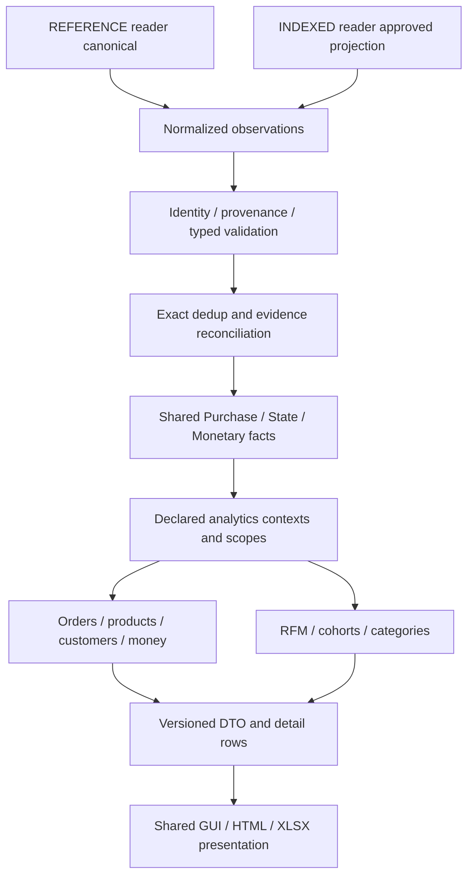

# STAT-STATUS-DESIGN-01 — единая модель покупок, отмен и возвратов

Дата: 06.11.2026. Проект `D:/RecommendationSystem`, ветка `feature/hybrid-ranking`, HEAD `2b56bb8fb7fa44fb2987407b0bb98fc3b7d6f3a5`. **DESIGN ONLY.** Этот документ и [реестр решений](statistics_status_decisions.md) не включают новую политику в приложение. Все имена будущих типов/версий ниже — проект, а не существующие API.

## 1. Executive summary

Предлагается один контракт **UNIFIED_PURCHASE_V1**: наблюдаемая поведенческая покупка F/sold/CP, отдельно состояние позиций/заказа, признанная стоимость и подтверждённые возвраты денег. Это не переименование STRICT/EXTENDED. Покупка одного заказа учитывается один раз; возврат не стирает подтверждённую историческую покупку. CP устанавливает частичное выполнение, но не полное выкупленное количество или сумму. Неизвестность имеет причину и качество, а не числовой ноль.

Два технических читателя REFERENCE/INDEXED должны отдавать эквивалентные нормализованные наблюдения в общий чистый конвейер (§16). Классификация, количество, разрешение снимков, формирование фактов и качество денег принадлежат этому конвейеру; агрегаторы не содержат собственных статусных списков. Различия аналитических scope остаются явными.

Без проверенных часов изменения нельзя заменить первый снимок последним. Минимальная модель достоверно описывает наблюдавшиеся состояния и наличие покупки, иногда без известной даты исполнения. Полный жизненный цикл, корректное состояние на прошлую дату, распределение CP и refund требуют DATA. Отсутствие этих данных блокирует соответствующие метрики, а не оправдывает их восстановление из firstAction. До готовности полного нового результата действующий legacy-отчёт остаётся действующим.

Прочитаны целиком [аудит статусов](statistics_status_audit.md), [инвентарь 43 кодов](statistics_status_inventory.csv), [аудит структуры UI](statistics_ui_structure_audit.md). Последний описывает более раннюю структуру: его B-ID используются как карта смыслов и scope, не как текущая инвентаризация интерфейса и не как одобрение скрытых таблиц. Реструктуризации 01–04 не пересматриваются; к 05 не возвращаемся.

Доказательная база повторно не сканировалась. Актуальные интерфейсы проверены точечно: [политики](../Application/statistics_purchase_policy.py), [PurchaseOrderFact](../Application/statistics_purchase_facts.py), [OrderSnapshots](../Application/mindbox/order_dedup.py), [_calculate_statistics](../Application/dataset_statistics.py), [проекция](../Application/statistics_facts.py), [IndexedInput](../Application/statistics_query.py), [index source_version](../Application/statistics_index.py), [fingerprint](../Application/statistics_slices.py), [cache](../Application/statistics_cache.py), [RFM](../Application/statistics_rfm_core.py), [когорты](../Application/statistics_cohorts_core.py), [детальный контракт](../Application/statistics_detail_contract.py), [представление заказов](../Application/statistics_report_presentation.py).

## 2. Согласованные бизнес-принципы

Согласованные направления D01–D07, D20, D22, D25–D26 отделены в реестре от рекомендаций DESIGN.

- Одна основная бизнес-политика; исторические Legacy/STRICT/EXTENDED не переименовываются.
- F/sold/CP — свидетельства наблюдаемой покупки; CP — частичное выполнение. Условия пригодности quantity и идентичности ниже являются предлагаемыми уточнениями, а не новым утверждением пользователя.
- delivering — незавершённое исполнение; сам по себе не покупка. Категория Mindbox «Доставлена» тоже не доказательство выполнения.
- Историческая покупка сохраняется после возврата. Только Return без наблюдавшейся покупки не создаёт покупку.
- Статус возврата, номинал возвращаемой позиции и подтверждённый refund — разные сведения.
- Нельзя автоматически признавать полные units/priceOfLine CP, условный процент или ноль.
- Все новые числа публикуются с версиями, качеством, scope и временем; старые результаты остаются под своим контрактом.
- Дизайн не разрешает миграцию ML, пересчёт статистики, построение индекса или изменение защиты.

## 3. Доменная модель

### 3.1. Минимальные структуры

Ниже конкретный эскиз Python 3.12 для будущего CONTRACT. Это декларации в документации, не production-реализация. `Measured` — общее значение с качеством; `SourceRef` и `AnalyticsContext` — небольшие value objects. Не нужны сервисы/фабрики для каждого типа. Части большого заказа можно хранить на диске и выдавать итератором; tuple в эскизе описывает логическую связь, не требование держать весь архив в RAM.

```python
from dataclasses import dataclass
from datetime import datetime
from decimal import Decimal
from enum import Enum
from typing import Generic, TypeVar

T = TypeVar("T")

class EvidenceQuality(str, Enum):
    KNOWN = "KNOWN"                 # value=0 тоже достоверное значение
    UNKNOWN = "UNKNOWN"
    INSUFFICIENT_COVERAGE = "INSUFFICIENT_COVERAGE"
    CONFLICT = "CONFLICT"
    INVALID = "INVALID"

@dataclass(frozen=True, slots=True)
class Measured(Generic[T]):
    value: T | None
    quality: EvidenceQuality
    reasons: tuple[str, ...]         # безопасные enum-коды, без raw/ID

class LineKind(str, Enum):
    COMPLETED = "COMPLETED"
    PARTIAL = "PARTIAL"
    ORDERING = "ORDERING"
    PAID_OR_IN_PROGRESS = "PAID_OR_IN_PROGRESS"
    DELIVERY_IN_PROGRESS = "DELIVERY_IN_PROGRESS"
    CANCELLED = "CANCELLED"
    RETURNED = "RETURNED"
    UNKNOWN_CODE = "UNKNOWN_CODE"
    MISSING_CODE = "MISSING_CODE"
    INVALID_CODE = "INVALID_CODE"

class OrderKind(str, Enum):
    COMPLETED_ONLY = "COMPLETED_ONLY"
    PARTIAL_ONLY = "PARTIAL_ONLY"
    CANCELLED_ONLY = "CANCELLED_ONLY"
    RETURNED_ONLY = "RETURNED_ONLY"
    IN_PROGRESS_ONLY = "IN_PROGRESS_ONLY"
    MIXED = "MIXED"
    EMPTY = "EMPTY"
    UNAVAILABLE = "UNAVAILABLE"
    CONFLICT = "CONFLICT"

@dataclass(frozen=True, slots=True, repr=False)
class SourceRef:
    source_id: str                  # manifest entry/part; приватная ссылка
    observation_id: str             # уникальное вхождение, не ID операции
    source_kind: str                # MANUAL_ORDERS/API_ORDERS/API_ACTION
    observed_at: Measured[datetime] # время наблюдения, не статусного перехода
    event_at: Measured[datetime]    # время действия, если подтверждено
    received_at: Measured[datetime] # creationTime действия, если доступно

@dataclass(frozen=True, slots=True)
class PurchasePolicy:
    policy_id: str                  # UNIFIED_PURCHASE_V1
    catalog_version: str
    snapshot_version: str
    time_version: str
    quantity_version: str
    monetary_version: str

@dataclass(frozen=True, slots=True, repr=False)
class OrderLineState:
    local_key: str                  # observation_id + ordinal
    stable_line_key: str | None     # приватный scoped SID; None допустим
    line_number: str | None         # не идентификатор
    source_status: str | None       # точный пригодный код; иначе None
    kind: LineKind
    nominal_units: Measured[Decimal]
    fulfilled_units: Measured[Decimal]
    currency: Measured[str]
    source_price: Measured[Decimal] # сумма строки, не цена единицы
    product_key: str | None         # разрешённый товарный ключ, не клиент
    sources: tuple[SourceRef, ...]

@dataclass(frozen=True, slots=True, repr=False)
class PurchaseEvidence:
    order_key: str                  # scoped private SID
    customer_key: Measured[str]     # без клиента доступна только order-аналитика
    line_keys: tuple[str, ...]      # известные свидетельствующие позиции
    observed_purchase: Measured[bool]
    purchase_at: Measured[datetime] # только согласованное основание времени
    basis: tuple[str, ...]          # STATUS_F/STATUS_SOLD/STATUS_CP/VERIFIED_EVENT
    sources: tuple[SourceRef, ...]

@dataclass(frozen=True, slots=True)
class MonetaryEvidence:
    currency: str                   # RUB или KZT; unknown отдельно в quality
    known_purchase_subtotal: Decimal
    recognized_purchase: Measured[Decimal]
    partial_nominal: Measured[Decimal]
    cancelled_nominal: Measured[Decimal]
    returned_nominal: Measured[Decimal]
    confirmed_refund_subtotal: Decimal
    confirmed_refunds: Measured[Decimal]
    net_after_refunds: Measured[Decimal]
    basis: tuple[str, ...]          # STATUS_CONFIRMED, ALLOCATION, REFUND_LEDGER

@dataclass(frozen=True, slots=True, repr=False)
class RefundEvidence:
    operation_key: str              # scoped operation SID, обязателен
    order_key: str
    line_key: str | None            # order-level refund допустим
    amount: Decimal                # finite >= 0; знак направления отдельный
    currency: str                   # RUB/KZT
    occurred_at: datetime           # UTC, не время выгрузки
    sources: tuple[SourceRef, ...]

@dataclass(frozen=True, slots=True, repr=False)
class OrderBusinessFact:
    identity_space: str             # один набор данных/поколение
    order_key: str
    created_at: Measured[datetime]
    current_kind: OrderKind
    state_quality: EvidenceQuality
    state_reasons: tuple[str, ...]
    state_flags: frozenset[LineKind] # только известные признаки
    lines: tuple[OrderLineState, ...] # согласованное состояние, не все версии
    purchase: PurchaseEvidence
    money: tuple[MonetaryEvidence, ...]
    refunds: tuple[RefundEvidence, ...]
    candidate_observations: tuple[str, ...] # private refs при конфликте

@dataclass(frozen=True, slots=True)
class AnalyticsContext:
    context_id: str
    policy: PurchasePolicy
    source_manifest_digest: str
    projection_version: str
    business_as_of: datetime        # UTC конец бизнес-горизонта, exclusive
    knowledge_as_of: datetime       # до какого поступления знаем сведения
    timezone: str
    period: tuple[datetime, datetime] | None
    product_filter_digest: str
    coverage_ref: str               # ссылка на типизированную карту покрытия
    capabilities: frozenset[str]    # проверенные возможности источников
```

### 3.2. Поля, формирование и инварианты

Все поля без `None` обязательны. Optional не означает ошибку сам по себе: например, отсутствие stable_line_key допускается, но запрещает доказательство межснимочной lineage. Datetime — aware UTC; интервалы `[start,end)`. Enum-коды причин и source_kind закрыты схемой CONTRACT; неизвестная версия не принимается как default.

| Объект | Формирование и обязательные инварианты | Связь / ограничения |
|---|---|---|
| Measured | KNOWN ⇔ value is not None; прочее ⇒ value=None; reasons непусты при недоступности. false/0 допустимы только KNOWN | Причины сохраняются все; `INCOMPLETE_LINES`, `UNKNOWN_CURRENCY`, `CP_ALLOCATION_UNKNOWN`, `MISSING_TIME`, `UNORDERED_SNAPSHOTS` не заменяются generic None |
| SourceRef | Строится техническим читателем с provenance; непроверенные времена UNKNOWN | observed_at не извлекается из firstAction; время публикации источника может быть лишь верхней границей наблюдения, с отдельной причиной/basis в карте coverage |
| PurchasePolicy | Один неизменяемый набор версий на расчёт; статусы покупки определяются каталогом+этой политикой | Список источников/ограничений — в AnalyticsContext/manifest, а не в имени альтернативной политики |
| OrderLineState | Классификация сохраняется даже при плохих qty/price; товар может не разрешиться | local_key уникален внутри наблюдения; stable_line_key уникален в согласованном состоянии; отсутствие ID не компенсировать совпадением товара |
| PurchaseEvidence | Объединение пригодных свидетельств одного заказа; True не зависит от пригодности цены | line_keys — ссылки на позиции либо приватные исторические наблюдения при смене состояния; они не обязаны находиться в текущих lines после возврата |
| MonetaryEvidence | Одна запись на валюту; subtotal finite >=0 и явно неполный при плохом total | Причины неизвестной валюты/нераспределённых позиций хранятся в state_reasons/quality каждого затронутого total; отсутствие money-записи не означает 0 |
| RefundEvidence | Только прошедшая проверку операция; неполные кандидаты остаются в приватных наблюдениях/диагностике, не в confirmed refunds | Повтор operation_key с тем же содержимым идемпотентен, с иным — конфликт; client/order/line связи проверяются |
| OrderBusinessFact | Один уникальный заказ после группировки наблюдений, единый identity_space | current_kind и historical purchase независимы; candidate refs не публикуются в агрегатном DTO |
| AnalyticsContext | Строится перед агрегацией; coverage_ref разрешается в карту интервалов с часами, source, holes, completeness и основаниями | Scope обязателен для каждой группы результата; связь context_id запрещает незаметное сравнение различных баз |

Качество не сводится к одной ранжированной причине: `reasons` содержит все дефекты. Для краткого отображения приоритет CONFLICT → INVALID → INSUFFICIENT_COVERAGE → UNKNOWN → KNOWN; это **предлагаемый** UI/DTO-приоритет, не правило починки данных. Известные частичные суммы хранятся отдельно от недоступного total. Валюта/время/количество/состояние имеют независимое качество. Пустая известная совокупность даёт известный ноль только при доказанном полном измерении; отсутствие источника даёт недоступность.

Минимальная модель не хранит все возможные поля API. Расширение RefundEvidence/SourceRef выполняется только по подтверждённому DATA-контракту. Группировка/дедупликация и временные индексы могут быть disk-backed, не дополнительными доменными сервисами.

## 4. Каталог и классификация статусов

Предложенная версия `MINDBOX_STATUS_CATALOG_V1` содержит 42 пользовательские тройки и отдельный технический код. Источник каждой строки — U1/инвентарь; подтверждение метаданных и подтверждение бизнес-классификации раздельны. Имя/категория технической отмены остаются `None`, display_label «Техническая отмена» не становится официальным именем. Нужны поля `external_id`, `name`, `mindbox_category`, `business_kind`, `purchase_candidate`, `cancel_flag`, `return_flag`, `metadata_version/source`, `metadata_confirmation`, `classification_confirmation`. Точные значения справочника:

| External ID | Название U1 | Категория Mindbox | Бизнес-группа | Покупка по статусу |
|---|---|---|---|---|
| `Mindbox-Tech-Cancellation` | не подтверждено | не подтверждена | CANCELLED | нет |
| `Return` | Возврат | Возврат | RETURNED | нет |
| `klientskii-vozvrat` | Клиентский возврат | Возврат | RETURNED | нет |
| `kurerskii-vozvrat` | Курьерский возврат | Возврат | RETURNED | нет |
| `CP` | Выполнен частично | Доставлена | PARTIAL | да |
| `F` | Выполнен | Доставлена | COMPLETED | да |
| `arrived-in-pickup-point` | Прибыл в ПВЗ | Доставлена | DELIVERY_IN_PROGRESS | нет |
| `de` | Доставка по графику | Доставлена | DELIVERY_IN_PROGRESS | нет |
| `ready-for-self-pickup` | Готов к самовывозу | Доставлена | DELIVERY_IN_PROGRESS | нет |
| `send-to-delivery` | Передан в доставку | Доставлена | DELIVERY_IN_PROGRESS | нет |
| `sold` | Продан | Доставлена | COMPLETED | да |
| `assembling-complete` | Укомплектован | Оплачена | PAID_OR_IN_PROGRESS | нет |
| `delivering` | Доставляется | Оплачена | PAID_OR_IN_PROGRESS | нет |
| `gotov-otpravka` | Готов к отправке (crm) | Оплачена | PAID_OR_IN_PROGRESS | нет |
| `prepayed` | Предоплата поступила | Оплачена | PAID_OR_IN_PROGRESS | нет |
| `redirect` | Доставка перенесена | Оплачена | PAID_OR_IN_PROGRESS | нет |
| `send-to-assembling` | Передано в комплектацию | Оплачена | PAID_OR_IN_PROGRESS | нет |
| `Оплачен` | Оплачен | Оплачена | PAID_OR_IN_PROGRESS | нет |
| `CD` | Отменен | Отменена | CANCELLED | нет |
| `RJ` | Отказ | Отменена | CANCELLED | нет |
| `already-buyed` | Купил в другом месте | Отменена | CANCELLED | нет |
| `delyvery-did-not-suit` | Не устроила доставка | Отменена | CANCELLED | нет |
| `no-product` | Нет в наличии (crm) | Отменена | CANCELLED | нет |
| `otmenen` | Отменён | Отменена | CANCELLED | нет |
| `out-of-stock` | Нет в наличии | Отменена | CANCELLED | нет |
| `DA` | Комплектация заказа | Оформлена | ORDERING | нет |
| `DB` | Готов к отправке | Оформлена | ORDERING | нет |
| `DD` | Комплектация заказа (некомплект) | Оформлена | ORDERING | нет |
| `DG` | Заказ отправлен | Оформлена | ORDERING | нет |
| `DS` | Доставлен в пункт самовывоза | Оформлена | ORDERING | нет |
| `N` | Принят | Оформлена | ORDERING | нет |
| `assembling` | Комплектуется | Оформлена | ORDERING | нет |
| `availability-confirmed` | Наличие подтверждено | Оформлена | ORDERING | нет |
| `client-confirmed` | Согласовано с клиентом | Оформлена | ORDERING | нет |
| `kv` | К выполнению | Оформлена | ORDERING | нет |
| `new` | Новый | Оформлена | ORDERING | нет |
| `no-call` | Недозвон | Оформлена | ORDERING | нет |
| `offer-analog` | Предложить замену | Оформлена | ORDERING | нет |
| `opr-perem` | Оприходовать перемещения | Оформлена | ORDERING | нет |
| `ready-to-wait` | Готов ждать | Оформлена | ORDERING | нет |
| `sh` | Собран в магазине | Оформлена | ORDERING | нет |
| `soglasovanie` | Согласование | Оформлена | ORDERING | нет |
| `tovar-naiden` | Товар найден | Оформлена | ORDERING | нет |

Отмена: CANCELLED, причина только из точного кода/названия (нет в наличии, отказ и т. п.). Возвратное состояние: RETURNED, три разных кода не сливаются при диагностике причин. Категория «Доставлена» включает четыре логистических кода `send-to-delivery`, `ready-for-self-pickup`, `arrived-in-pickup-point`, `de`: они не создают покупку. PAID_OR_IN_PROGRESS не подтверждает банковскую оплату самим названием.

Код сравнивается точно, с учётом регистра, без strip/casefold и исправления опечаток. Пригодная непустая строка вне справочника — UNKNOWN_CODE, исходный код сохраняется. Отсутствующий/null/пустой код — MISSING_CODE; bool/число/объект, пробельная или с краевыми пробелами строка — INVALID_CODE. В диагностике хранится безопасный reason/type, не произвольный raw-объект. UNKNOWN не превращается в отмену/возврат/покупку. Обновление каталога меняет версию и fingerprint; назначение неизвестного кода требует подтверждённых метаданных/бизнес-правила.

Будущая полная таблица — union всех 43 известных кодов с пригодными unknown-кодами и отдельными MISSING/INVALID bucket. Определённая полная область без вхождений даёт 0; не проверенная область — «недоступно». Сохраняются три стадии счётчиков: `raw_line_occurrences`, `resolved_current_positions`, `historical_purchase_positions`. Их нельзя складывать или выдавать за одно распределение. Current-позиции при конфликтной identity/state не «измерены полностью»: известный subtotal и unresolved отдельно. Число уникальных заказов по строкам пересекается; заказ F+CD входит в обе строки, сумма строк не равна общему числу заказов. Фильтр и стадия одинаковы у всех строк одной таблицы, включая нули. Unknown-код не печатается в свободных логах: представление ограничивает длину, экранирует HTML и spreadsheet-formula, агрегированные причины обходятся без значений.

## 5. Правила Purchase Evidence

Предлагаемый квалифицирующий gate D08: валидная identity заказа, F/sold/CP и конечное положительное целое nominal quantity дают положительное свидетельство. Отсутствие цены/неизвестная валюта не удаляет его. Разрешение товарного ключа не требуется для all-products факта, но требуется для товарного среза/категории. Вкладка «Действия» и пересечения VIEW/FAVORITE/PURCHASE в будущем получают PURCHASE из этого же потока заказов: техническое действие изменения статуса не считается вторым покупочным взаимодействием. Заказные позиции и цифровые действия сохраняют разные гранулярности; новая миграция должна охватить и общий InteractionBuilder-путь статистики, не только buyer/RFM (D30). ML-путь при этом остаётся прежним. F/sold/CP с неподходящим qty сохраняют статусное свидетельство и диагностику; не создают обычную принятую покупочную позицию. Это уточнение должно быть утверждено в CONTRACT, поскольку пользователь согласовал сами статусы, а не все ошибочные входы.

Псевдокод общего построителя:

```text
read and validate source provenance / timestamps / identities
normalize each observation without dropping invalid line diagnostics
exact-deduplicate observations, preserving source references
reconcile order identity, line identity and temporal candidates (§9)
for each unique order:
    positive_claims = valid F/sold/CP claims known by knowledge_as_of
    observed_purchase = TRUE if any non-conflicting ownership claim exists
    otherwise FALSE only for a complete relevant history with no claims
    otherwise UNKNOWN / CONFLICT with explicit reasons
    preserve purchase even if a subsequent verified return changes current state
    purchase_at = earliest verified execution time among accepted claims
    mark unknown if an undated earlier claim could change first-time attribution
    build state / nominal quantities / fulfilled quantities / monetary evidence
    emit one OrderBusinessFact; aggregators apply their declared context
```

Нет положительных свидетельств ≠ доказательство «никогда не покупал». Можно достоверно сказать `qualified_purchase_orders_observed=0` в полностью прочитанном срезе наблюдений, даже если полнота жизненного цикла неизвестна; это иной показатель, чем `never_purchased`. Число наблюдаемых покупок — дедуплицированные order_key; оно не растёт с количеством позиций, снимков или переходов CP→F. Известные отказы/CD не отнимаются от него. Return-only имеет zero observed purchase events, а не восстановленную предыдущую покупку.

Если нет клиента, валидный заказ/его покупка доступны в order-аналитике, но число идентифицированных покупателей и клиентские метрики неполны. При конфликте владельца один заказ не назначается двум клиентам; клиентские значения CONFLICT, факт/статусы заказа отдельно. Order key должен включать tenant/источник идентичности; одинаковый ID в частях одного canonical объединяется, в независимых пространствах не склеивается. Межисточниковое соответствие Mindbox/retail/external IDs нельзя угадывать.

## 6. CP и качество количества

| Quantity / identity | Статусная диагностика | Предлагаемый бизнес-результат |
|---|---|---|
| finite integer >0 | Сохраняется | Принятая позиция F/sold/CP; nominal_units известны |
| 0 | Сохраняется, ZERO_QUANTITY | Нет квалифицированной покупки от этой позиции; nominal_units=0 KNOWN, fulfilled неизвестны/неприменимы; это устраняет Legacy purchase от нуля |
| -1 / иное отрицательное | INVALID_NEGATIVE_QUANTITY | Нет принятой позиции; не трактовать знаком как возврат |
| Дробное >0 | UNSUPPORTED_FRACTIONAL_QUANTITY | Нет округления/усечения; nominal исходное значение сохраняется приватно, бизнес units INVALID |
| None | MISSING_QUANTITY | Статус известен; eligibility/units UNKNOWN; итог состава покупок может быть неполным |
| bool, строка, объект, NaN/Infinity | INVALID_QUANTITY | Нет implicit numeric coercion или BPR clipping; бизнес units INVALID |
| Нет line ID | Сохраняются local_key и ordinal | Один заказ может иметь purchase=True, но позиции между снимками не отождествляются автоматически |
| Повтор line ID внутри снимка | DUPLICATE_LINE_ID | identity CONFLICT, нельзя суммировать строки с повтором как разные продажи |
| Split | Только при проверенной явной lineage | Потомки не дополнительные заказы; predecessor и children не суммируются как одновременно проданные единицы |

`nominal_units` — количество из пригодной строки. `fulfilled_units`: для F/sold proposed равно nominal_units только при отсутствии конфликтов/split и подтверждении контракта их полной позиции (D09); для CP всегда UNKNOWN без проверенного распределения. CP с quantity=5 и price=1000 означает одну покупочную позицию и один покупочный заказ, nominal_units=5, partial_nominal=1000 при известной валюте; fulfilled_units и recognized_purchase неизвестны. Нельзя назвать 5 выкупленными единицами, 1000 признанным оборотом или заменить их на 0/50%.

Количество строк (`positions` int), единицы (`Decimal`), уникальные заказы (`int`) и покупатели (`int`) отдельны. При другой пригодной F-позиции invalid CP не удаляет уже доказанную покупку заказа, но делает полные counts/units/amount недоступными там, где её неопределённость влияет на итог. Известные принятые positions/subtotal показываются как известная часть, не полная оценка. При пропущенном ID строки нельзя межснимочно суммировать исторические positions/units; счетчик raw occurrence измерить можно. Категория CP — наблюдаемое участие категории в частичном выполнении, не доказательство выкупа всех её единиц.

## 7. Смешанные заказы и отмены

Независимые order flags `has_completed`, `has_partial`, `has_cancelled`, `has_returned`, `has_in_progress`, `has_unknown` выводятся из известных line states; `has_historical_purchase` выводится отдельно из evidence. Они пересекаются. Для UI нужна одна категория текущего состояния, с приоритетом недоступности: конфликт непорядоченных наблюдений → CONFLICT; отсутствующая/неполная структура или unknown/missing/invalid статусы → UNAVAILABLE; известный пустой набор → EMPTY. Иначе таблица:

| Согласованный полный набор line states | OrderKind | Независимые сведения |
|---|---|---|
| Только F/sold | COMPLETED_ONLY | completed; покупка при qty gate |
| Только CP | PARTIAL_ONLY | partial; покупка при qty gate |
| F/sold + CP | MIXED | completed + partial, один заказ-покупка |
| F/sold + CD/иная отмена | MIXED | purchase + cancellation |
| F/sold + Return | MIXED | purchase + return-state; сумма refund ещё неизвестна |
| CP + Return | MIXED | partial + return-state; признанная сумма CP неизвестна |
| Только отмены | CANCELLED_ONLY | все наблюдаемые позиции отменены |
| Только возвратные коды | RETURNED_ONLY | все наблюдаемые позиции в возвратном состоянии |
| Только ORDERING/PAID_OR_IN_PROGRESS/DELIVERY_IN_PROGRESS | IN_PROGRESS_ONLY | in_progress; категории внутри могут различаться |
| F/sold + paid/in_progress | MIXED | известная покупка не означает полного исполнения заказа |

Качество qty/денег само по себе не стирает достоверные статусные флаги; полнота структурного состава и identity — отдельные условия. «Все позиции возвращены» относится к полному текущему составу, **не** доказывает полный возврат всех исторически выкупленных units/денег. Метрика «полностью возвращённая историческая покупка» доступна только с полной lineage/fulfilled/returned allocation, иначе недоступна. Аналогично «частичный возврат» как количественная доля требует данных; F+Return даёт достоверное смешанное возвратное состояние, не вычисленный процент.

Отмены: `cancelled_positions`, `orders_with_cancel`, `cancelled_only_orders`, `mixed_orders_with_cancel`, `identified_customers_with_cancel`, распределение точных cancel codes. Позиции и заказы считают один раз в согласованном состоянии выбранного as-of. Покупатели — уникальные идентифицированные клиенты заказов, не «покупатели» в смысле совершивших покупку; подпись должна быть «клиенты с отменами». При неполноте показывать known subtotal + unavailable total. Сумма причин по позициям допустима в одной стадии; суммы order/customer buckets неаддитивны. Причины вне кода не придумывать.

## 8. Возвратные состояния и денежные возвраты

Состояния: `returned_positions`, `orders_with_return_state`, `returned_only_orders`, `mixed_orders_with_return_state`, `identified_customers_with_return_state`; verified full/partial historic returns — отдельно. Повтор Return в десяти снимках не десять возвратов: текущее состояние дедуплицируется по согласованной позиции, исторические состояния не суммируются в число операций.

Подтверждённый RefundEvidence требует: стабильный scoped operation ID, finite amount >=0, RUB/KZT, надёжное UTC время операции, связь с исходным заказом, проверенный источник. Для line/category refund нужна проверенная связь с позицией/lineage. `returnedPayments` — кандидат-источник, а не автоматически доверенный ledger: DATA подтверждает смысл, идентификаторы, знаки, дату и полноту. Payment amount и refund amount не взаимозаменяемы; payment.type не доказывает ни того ни другого.

| Сведения | Допустимо | Недопустимо |
|---|---|---|
| Return + nominal price | Возвратное состояние, известный номинал | Подтверждённый денежный refund, обратная покупка |
| Валидная операция с order link, без line link | Order-level confirmed refund; сумма/число уникальных операций | Line/category allocation, полное возвращённое quantity |
| Нет order link или operation ID | Кандидат, причины недоступности, известный непроверенный номинал отдельно | Включение в confirmed total и произвольная дедупликация по сумме/дате |
| Повтор того же ID и содержания | Одна операция, redelivery diagnostic | Удвоение суммы |
| Тот же ID с иной суммой/валютой/датой | CONFLICT, не суммировать варианты | «Последнее» без версии/revision контракта |
| Два разных подтверждённых partial refund ID | Сумма один раз каждой операции | Вычитать один и тот же номинал Return дважды |
| Нет refund записей, полнота не доказана | UNKNOWN confirmed total/net | KNOWN 0 |
| Полный проверенный ledger без refund | KNOWN 0 refund | Считать ноль лишь из отсутствия поля |

Без проверенной политики корректировок refund сверх признанного gross — несогласованность для связанного товарного net; известные операции остаются диагностируемыми, net CONFLICT. Законные дополнительные компенсации/доставка/бонусы требуют отдельного вида операции и согласования, не обрезки суммы до gross. Отсутствие line link не блокирует order-level refund, если order link надёжен; отсутствие подтверждённой покупки блокирует сопоставимый purchase-net, но не превращает реально подтверждённую refund operation в ноль.

## 9. Временная модель и снимки

### 9.1. Часы и as-of

| Время | Сейчас подтверждено аудитом | Правило новой модели |
|---|---|---|
| order_created_at | Orders firstAction.dateTimeUtc используется как дата заказа | Не доказательство оплаты/исполнения/возврата |
| action_occurred_at | В raw Action есть event datetime | Использовать только после проверки смысла и историчности payload |
| action_received_at | Отличающееся creation datetime в raw Action | Часы поступления/экспорта; не подмена event time |
| state_observed_at | Файл/источник имеет provenance/публикацию; точный момент snapshot неизвестен | UNKNOWN либо доказанный интервал/верхняя граница; publication timestamp не точный статусный переход |
| fulfillment_at | В текущем общем факте отдельно не представлен | VERIFIED_EXECUTION_TIME_V1 — предлагаемое основание; UNKNOWN, пока не подтверждено |
| refund_at | Не подтверждён текущим контрактом | Только время проверенной финансовой операции |
| business_as_of / knowledge_as_of | Сейчас один order-date gate, не bitemporal lifecycle | Два явных cutoff: что произошло до даты и что было известно на момент расчёта |

Итоговая дата покупки предлагается как самая ранняя подтверждённая дата исполнения F/sold/CP в одном заказе. Последующее CP→F не создаёт новую покупку и не переносит её дату. Если есть более раннее недатированное положительное свидетельство, точная первая дата UNKNOWN. Несколько позиций исполняются в разные дни: для поведения один первый qualifying момент; для финансов операции/распределения имеют собственные даты. Полная стоимость заказа на первом частичном исполнении автоматически не признаётся.

**Не устанавливать firstAction как purchase_at по умолчанию.** Альтернатива «дата оформления заказа, который позднее наблюдался купленным» полезна как явно обозначенная proxy-аналитика, но требует отдельного решения D13; это не доказательство покупки на дату оформления и не вторая основная статусная политика. Пока время не подтверждено, minimum может сообщить «покупка наблюдалась, дата исполнения неизвестна», но не распределить её по историческим RFM/когортам.

Факт, наблюдённый после business_as_of, без надёжной event date нельзя задним числом включить в прошлое. При verified event_at <= business cutoff, но received_at > knowledge cutoff событие не включается в воспроизведение знания на старую дату; более поздний расчёт является новой версией результата и явно отражает late evidence. Равенство cutoff обрабатывается единообразно как `[start,end)`, календарное отсечение переводится в следующий день в объявленной timezone.

### 9.2. Согласование наблюдений — предложение D11

1. Валидировать provenance, scoped order identity/customer merges и доступность cutoff; сохранить raw occurrence order только для воспроизводимости/диагностики. Порядок частей не равен порядку событий.
2. Точный fingerprint полного raw выявляет identical redelivery. Отдельный versioned business-state fingerprint сравнивает только нормализованные значимые поля; лишняя metadata может дать raw conflict без изменения business state. Обе диагностики сохраняются. В business fingerprint входят scoped identity/owner, line identity/lineage, точный статус, типизированные qty/price/currency/product, значимые даты и основания, канал/прочая используемая аналитикой metadata. Decimal нормализуется по числовому значению; invalid inputs сравниваются по безопасному type/reason и сохранённым допустимым scalar полям. Строки с доказанными уникальными stable_line_id сравниваются по ID, без ID сохраняется ordinal и не заявляется эквивалентность переставленных строк. Нельзя удалить из fingerprint поле, от которого зависит любой consumer. Exact hash хранится из raw, а не восстанавливается из неполной проекции.
3. Сгруппировать все относящиеся наблюдения заказа **до** товарного отбора и до бизнес-отбора по purchase_at. Иначе ранний in-progress и поздний F оказываются в разных победителях. Технический source clock gate не выдавать за бизнес-период.
4. Стабильные line IDs и явная lineage позволяют сопоставлять состояния. Без них нет объединения по product/line number/ordinal; локальное состояние снимка доступно, межснимочные units/money/position totals неполны.
5. Если DATA подтвердит исторические события/даты/полную позиционную семантику и revision ordering, выбрать последнюю применимую версию каждой позиции по **проверенному** event/revision порядку в пределах cutoff. Исчезновение строки не является отменой без full-snapshot контракта.
6. Если одинаковые business states — один state с несколькими source refs. Если содержания отличаются и надёжного порядка/приоритета нет — CONFLICT, candidate frontier без произвольного winner. Равновременные несовместимые события без revision tie-break также конфликт. Лексикографический ID допустим для стабильной сортировки вывода, не для выбора истины.
7. Историческое положительное свидетельство сохраняется независимо от текущего состояния. В конфликтной frontier F/Return можно утверждать наблюдение F при валидной identity, но нельзя утверждать, что Return позже, выбрать текущую версию или сложить обе nominal суммы. Конфликт самой identity/владельца блокирует затронутую purchase attribution.

Поле `current_kind` означает согласованное **наблюдаемое** состояние, а не безусловно последнее фактическое состояние магазина. В AnalyticsContext/coverage явно указывается `state_basis=OBSERVED_SNAPSHOT` либо `VERIFIED_EVENT_ASOF`. При неизвестном времени наблюдения допустим описательный snapshot scope; он не проходит historical business-as-of gate как доказанное состояние на прошлую дату. Точные времена в SourceRef остаются UNKNOWN, интервальные границы/основания и provenance помещаются в temporal metadata карты coverage.

Текущий MANUAL precedence в canonical effective_entries выбирает источники по покрытию, не устанавливает статусную хронологию. Для новой модели требуется manifest участия источников и явно проверенная политика overlap: если canonical исключает API на MANUAL-интервале, не объявлять, что просмотрены все версии. Не менять canonical; при недостаточности исходного набора поставить coverage BLOCKED_BY_DATA. Не назначать MANUAL/API безусловным бизнес-winner. Текущий глобальный OrderSnapshots не меняется; новый reconciler появится только в отдельной реализации нового контракта.

## 10. Событийная модель и ограничения данных

| Уровень возможностей | Что можно обещать | Чего нельзя обещать |
|---|---|---|
| Минимум: Orders observations + provenance | Точные коды, raw counts, согласованные состояния/конфликты, наблюдаемая покупка, nominal price/qty, качество | Полный lifecycle, точное historical as-of, дата исполнения, CP fulfilled allocation, refund/net |
| Проверенные Actions с историческим order payload | Evidence transitions/times, если clock/ID/link/coverage подтверждены | Полноту всего архива только потому, что найдены восемь событий |
| Проверенные split/fulfillment/refund операции | Количество/деньги/времена с подтверждённой lineage и ledger coverage | Недостающие операции, банковскую оплату из статуса F |

Аудит: P1 — 384 заказа/813 строк, P2 — 615 действий до восьми status-change events; это ограниченные префиксы, не глобальная проверка отсутствующих полей. Текущий Projector.action не сохраняет action ID, creation time, order linkage/payload. Возможности API из официальных источников, уже приведённых в [аудите, §19](statistics_status_audit.md), не доказывают поведение tenant-интеграции. Здесь нового исследования raw или онлайн-документации не выполнялось.

Контракт следующего **STAT-STATUS-DATA-01**, только отдельная задача:

| Проверка | Нужное подтверждение / критерий выхода |
|---|---|
| DATA01 — tenant catalog | Свежие точные 42+ коды/имена/категории; отдельно official metadata технической отмены; версия/ответственный |
| DATA02 — CP | Обезличенные примеры сверенные с учётом магазина: nominal/fulfilled/cancelled/returned qty и price; смысл CP и F/sold, zero price, частичные оплаты/выкупы |
| DATA03 — Actions historical | Одному order ID сопоставлены последовательно разные payload; доказано, что order отражает состояние на event time, а не текущее состояние на выгрузку |
| DATA04 — clocks/late events | event vs creation vs export changed clock, timezone, точность, ties/revision, позднее поступление; watermark и воспроизводимость knowledge cutoff |
| DATA05 — coverage | Полнота Actions/Orders/MANUAL периода, gaps/overlap/ручные части/события за пределами created диапазона; какое покрытие относится к какому clock |
| DATA06 — identity/splits | Стабильные order/line/action IDs, tenant scope, merges, retail mapping, split predecessor/children, line number, отсутствие/повтор ID, повторный split |
| DATA07 — financial ledger | returnedPayments/операции: ID, знак, amount, currency, дата, исходный order/line link, corrections, redelivery, частичный/повторный refund, completeness |
| DATA08 — allocation | Скидки/доставка/бонусы/платежи/totalPrice vs priceOfLine; CP allocation, order refund без line allocation, unknown namespace/mixed currency |
| DATA09 — reconciliation | Можно ли установить authoritative state order при conflicting snapshots, full/delta payload и исчезновении строки; не выводить порядок из порядка файлов |

Результат DATA — агрегированные доказательства/схемы и capability matrix с границами, без ID/контактов/raw payload в отчётах. Нет доказательства → соответствующий gate остаётся закрытым. Никакой полноты «по умолчанию»; отсутствие events не разрешает реконструкцию. Минимум может быть реализован отдельно, но не должен публиковаться как полная миграция RFM/когорт.

## 11. Денежный контракт

Предложение D15: деньги — Decimal из исходных пригодных чисел, finite и неотрицательные для purchase/refund amount; bool/строки/NaN/Infinity/отрицательная цена — INVALID, отсутствующая цена — UNKNOWN. Ноль цены KNOWN, если сама позиция/валюта/основание пригодны. priceOfLine — **сумма строки**, поэтому не умножается на quantity. Расчёт не округляется ради отображения; форматтер денег отвечает за два знака только в GUI/HTML/XLSX. Сумма позиции в F/sold — признанная стоимость на статусном основании `STATUS_CONFIRMED`, не доказательство банковского поступления. Применимость к исправленным/разделённым позициям должна пройти DATA02/06/08 и CONTRACT.

Валюта: versioned `NAMESPACE_CURRENCY_V1`, `offline1C→RUB`, `kanzlerKz→KZT` соответствует нынешнему [CURRENCY_BY_NAMESPACE](../Application/order_statistics.py). Неизвестный namespace не угадывается по сумме/магазину; противоречащее явное currency поле — CONFLICT до проверенного правила приоритета. Валидные валюты не конвертируются и не суммируются. Смешанный order может иметь раздельные RUB/KZT known subtotals, но не единый чек или одновалютную полную M без проверенной атрибуции. Неатрибутированная валюта остаётся отдельной причиной неполноты и не исчезает из знаменателя качества.

| Показатель | Основание / правило |
|---|---|
| source_price / nominal | Пригодный priceOfLine в конкретном наблюдении, валюта и state context |
| recognized_purchase | F/sold с достоверной строкой и денежной оценкой; CP — только подтверждённая fulfilled allocation, иначе UNKNOWN |
| partial_nominal | Известная исходная сумма CP, без обещания полного выкупа |
| cancelled_nominal | Известная сумма отменённого текущего состояния; не потерянная выручка и не отрицательный purchase |
| returned_nominal | Известная сумма возвратного текущего состояния; не confirmed refund |
| confirmed_refunds | Уникальные verified operations с сопоставимыми currency/order/time; полнота ledger обязательна для полного total |
| net_after_refunds | recognized_purchase минус confirmed_refunds лишь для связанной одной базы исходных покупок, валюты и согласованного refund cutoff при полной оценке |

Для каждого order/currency `known_purchase_subtotal = sum(достоверно оценённых qualifying purchase allocations)`; `recognized_purchase` KNOWN только если все относящиеся allocations оценены, identity/snapshot/currency не конфликтуют и нужный scope полон. Иначе total=None с причинами, subtotal остаётся. Аналогично refund subtotal и полный refund total. Если обнаружена неизвестная валюта покупки, полные денежные итоги затронутого scope недоступны; известные RUB/KZT subtotal не выдаются за полную клиентскую сумму. Нет money rows — потребитель проверяет quality/coverage, не использует `sum(empty)=0` как знание.

Полная M покупателя требует всех пригодных покупочных заказов окна с полной суммой и однозначной валютной принадлежностью; один CP с неизвестной стоимостью делает M неполной. Сумма известных F остаётся справочным подытогом. Mean/median/квинтили считают только отдельно названную полностью оценённую базу с `valued_orders/valued_buyers`, числом неоценённых и качеством покрытия; нельзя делить известный subtotal на все покупки и называть это полным средним чеком. Полнота валюто-базы/48M истории тоже отдельное условие, не только валидность price.

Конкретные проверки арифметики/смыслов (не реальные данные):

| Вход | Поведение | Деньги |
|---|---|---|
| F qty=2 price=100 RUB | 1 order, 1 position, nominal/fulfilled 2 при DATA02 | recognized=100, не 200 |
| F price=0 RUB | Покупка сохраняется | recognized=0 KNOWN, если иных дефектов нет |
| F 100 + CP nominal 50 RUB | 1 order, 2 observed purchase positions | known subtotal=100; partial nominal=50; full recognized=UNKNOWN; не 150 и не 100 как полный итог |
| Только CP price=0 qty=5 | 1 observed order | nominal=0, recognized/fulfilled UNKNOWN; нулевая цена не доказывает allocation |
| F 100, verified refund 30, полный связанный ledger | Покупка остаётся | gross=100, refund=30, net=70 |
| F 100, Return nominal 100 без ledger | Покупка при историческом evidence остаётся | gross=100; refund/net UNKNOWN, не 100/0 |
| F 100, два разных verified refund 20 и 30, полный ledger | F неизменна | refund=50, net=50; redelivery первого refund не меняет сумму |
| F 100 RUB + F 200 KZT | Один заказ, разные валютные компоненты | subtotal RUB100/KZT200; единого 300 нет; single-currency чек/полная M недоступны |

Gross status-confirmed purchase — поведенчески связанная признанная стоимость; cash received, retained turnover, nominal cancelled/returned и net — разные меры. Для purchase-attributed net нужна cohort/window исходной покупки и refund cutoff (может быть позже окна); для cash-flow периода refund по собственной дате — иной context. Их не смешивать в одной колонке. Базовая M для RFM предлагается **gross recognized**, поскольку возврат не стирает поведение; net предлагается дополнительной финансовой мерой, не второй политикой покупки. Это D17 `PROPOSED`, а не уже одобренный денежный бизнес-стандарт. Условия доставки/бонусов/небанковских оплат — D16/D24, отдельные данные и согласование. Без них не называть net «чистой выручкой».

## 12. Клиентская аналитика

### 12.1. Поведение и scope

Все агрегаторы потребляют один PurchaseEvidence на order key. Одно исполнение нескольких позиций/несколько snapshots/CP→F не создают повторность. Два разных заказа — две покупки. Подтверждённый последующий полный возврат второй сохраняет F=2 и repeat=True; денежный net меняется отдельно. Return-only не является первой/второй покупкой и не создаёт активность retention.

| Контекст | Сохраняемая база / фильтры | Прозрачность результата |
|---|---|---|
| orders.product_slice | Пользовательские даты и товарный предикат; order counts после согласования всего заказа, затем проекция выбранных позиций | Состояние всего заказа и состояние товарного среза маркируются отдельно; нельзя назвать весь заказ cancelled по одной выбранной CD |
| customer_population | Все идентифицированные клиенты, в т. ч. без товарных событий/только профили; доступность источников отдельно | «Нет наблюдаемых покупок» не «никогда не покупал» |
| buyer_period | Собственный Orders-период, все товары | Не подменять покупателями товарного среза; первая в периоде не обязательно первая в истории |
| rfm_48m | 48-месячная база, окна12/24/48 и предыдущий12, существующий cutoff/coverage/валюта | Не использовать period фильтра покупок как новое RFM окно |
| cohorts_history | Полная доступная история до cutoff; выбранный период отбирает месяцы первых наблюдаемых покупок | Не считать клиента новым для магазина без всей предыдущей истории |

Эти контексты имеют общий AnalyticsContext, но разные context_id/period/filter/coverage. Во всех вкладках сохраняются даты, товары, клиенты, Orders-покрытие, 48M и cohort scope; одна политика не делает их знаменатели одинаковыми. Факты строятся до product filter, затем аналитические представления отбирают соответствующие позиции; историческая identity/дедупликация не повторяется другим статусным правилом на каждом срезе.

### 12.2. Первая/вторая покупка и RFM

Первая/вторая — минимальные два уникальных order key по пригодному purchase_at, а не первое появление в файле. Равные проверенные даты сортируются существующим стабильным order-ID rank, одинаково REF/INDEXED: это техническая воспроизводимость при равном времени, не установление причинной последовательности исполнения. При неразличимом времени разница=0; attribution first/second в таком tie помечается tie и не интерпретируется причинно. Нет purchase_at или возможно более раннее undated evidence → first/second/month/interval UNKNOWN, а не пропуск неудобного заказа. Известное количество наблюдаемых покупок вне временного окна при этом может сохраняться.

R — as-of минус последняя пригодная дата покупки; F — уникальные qualifying заказы в окне; M — предлагаемая gross recognized стоимость в окне по валюте с полным качеством. Для однозначности предлагается **order-attributed M**: в окно входят заказы по первому verified purchase_at; для них суммируется признанная стоимость, подтверждённая к business/knowledge cutoff. Позднейшее исполнение другой позиции того же заказа не создаёт новый F и не переводит заказ в новое окно; если первая покупка до окна, последующее доисполнение не добавляется в M этого окна. Поток признаний/платежей по собственным датам — отдельная финансовая метрика. Это уточнение D17 требует CONTRACT, а не вывод из текущего DTO. Недатированное evidence, способное попасть в окно, делает R/window F/M недоступными, даже если all-observed order count известен. Это не отказ от сохранения исторических покупок: их оконное расположение ещё не установлено.

Не меняются окна12/24/48, прежний12, базовый48M отбор, существующее правило валютной базы и квантильного ранжирования. В CONTRACT их алгоритмические определения переносятся без произвольной новой нормировки; новая популяция может изменить пороги и сегменты — это ожидаемое следствие, а не сохранность чисел. CP-first с датой может определять R/F и первый order; его неизвестная M → UNSCORABLE. Даже при известных других F-суммах M не становится полной. Недоступные R/F также не получают выдуманные баллы: сегмент недоступен/UNSCORABLE с причинами согласно будущему DTO. Известные денежные подытоги UNSCORABLE остаются видимыми.

### 12.3. Когорты, retention, каналы и категории

Первая наблюдаемая покупка может быть CP; при verified дате она задаёт cohort month, вторая — следующий уникальный заказ. Возврат второй не отменяет наблюдённый повтор/активность в месяце покупки и не создаёт активности месяца возврата. Стоимость второй может быть неизвестной; денежные метрики не обнуляются, их valued denominators/quality отдельны.

Сохраняются горизонты30/60/90/180/365, calendar M0–M12, существующие включительные/исключительные границы и условия eligibility/censoring, документированные/проверяемые в [statistics_cohorts_core.py](../Application/statistics_cohorts_core.py). Изменяется входное определение покупки/даты, а не длины горизонтов или формулы знаменателей. Repeat-by-H и active-in-Mn не взаимозаменяемы. `qualified/eligible`, `censored`, `coverage_incomplete`, их пересечения и наблюдаемые вне eligible — остаются отдельными полями. Дыры покрытий не маскируются общей длительностью.

Критическое уточнение coverage: интервал экспорта по order changed time или Action creation time не доказывает полноту event time/first-purchase history. Пока DATA05 не подтвердит преобразование часов и late-watermark, новые timed метрики отмечают INSUFFICIENT_COVERAGE; нельзя сохранить старое слово FULL, приписав ему более сильный смысл. Это явная причина изменения доступности, без замены знаменателя на всю наблюдаемую базу. Не исключать unknown-time клиентов молча ради красивой доли; отдельно unresolved count и недоступный полный итог.

Каналы первой/второй покупки используют канал соответствующего подтверждённого заказа/события по согласованному DATA-контракту; firstAction.channel может быть каналом оформления, а не исполнения — название основания сохраняется. Нет канала → unknown bucket, не другой заказ. Прямые товарные категории и пары берутся из квалифицирующих F/sold/CP позиций; CP — наблюдаемое участие категории в частичном выполнении, без доказательства выкупа всех units. Совместные пары/категории считают уникальные заказы/покупателей, не умножают на quantity и не включают Return как новую продажу. Неполная lineage/товарное разрешение → известные категории + качество неполноты, без произвольной реконструкции корзины. Не менять direct-category на parent-rollup. Первая в товарном срезе, первая за период и первая в полной доступной истории остаются разными ответами.

## 13. Влияние на BPR/гибрид

Аудит установил зависимости: Mindbox training использует Legacy InteractionBuilder/selection; CSV-подготовка имеет собственные CP/delivering/F и coercion; BPR quantity clipping не равен аналитическому qty gate. purchased_products имеет отдельные неполные cancel/return множества, hybrid исключает purchased/uncertain, activity/propensity тоже используют свои классификации. Полная карта и кодовые ссылки — [аудит, §12–13](statistics_status_audit.md).

| Вариант | Плюсы | Минусы / риски миграции |
|---|---|---|
| A. Статистика новая, ML временно прежний | Нет скрытого переобучения/смены кандидатов; можно внедрить статистику отдельно | Временное различие бизнес-фактов; обязательны labels/version отчётов и training lineage |
| B. Перевести ML отдельной задачей | Можно сравнить новые positives и качество | Сразу меняет train/test labels, веса, признаки, исключения; нужны переобучение/оценка и rollout моделей |
| C. Общие Purchase Evidence, свои label/weight/exclusion policies ML | Общий проверенный исходный факт без смешения финансов и интереса | Нужна versioned ML policy; совместимость model artifacts и независимо проверенные consumers |

Рекомендация D23: **A сейчас, затем C после отдельной задачи**; B — согласованная миграция consumers, а не побочный эффект константы. Новый ML label может использовать historical purchase независимо от net/refund, но вес/отрицательный сигнал/исключение товара не выводятся автоматически из суммы возврата. Return-only не должен создавать положительный label. Нет автоматического удаления positive после финансового возврата. Версии training dataset, event/feature/weight policies, purchased/uncertain rules, model artifacts, evaluation labels и hybrid parameters фиксируются отдельно. Нынешние BPR, clipping, признаки, propensity, evaluation, purchased-exclusion и hybrid не изменены; отдельное одобрение D24 требуется до любого такого перехода.

## 14. DTO и версионирование

Предложенный envelope нового результата (не production DTO):

```json
{
  "schema_version": 11,
  "contract_id": "UNIFIED_PURCHASE_V1",
  "versions": {
    "catalog": "MINDBOX_STATUS_CATALOG_V1",
    "snapshot": "EVIDENCE_RECONCILIATION_V1",
    "time": "VERIFIED_EXECUTION_TIME_V1",
    "quantity": "POSITIVE_INTEGER_EVIDENCE_V1",
    "monetary": "RECOGNIZED_WITH_QUALITY_V1",
    "projection": "STATISTICS_OBSERVATIONS_V1"
  },
  "contexts": [],
  "coverage": [],
  "capabilities": [],
  "orders": {}, "purchases": {}, "cancellations": {},
  "return_states": {}, "refunds": {}, "monetary": {},
  "customers": {}, "rfm": {}, "cohorts": {},
  "status_catalog": [], "diagnostics": {}
}
```

Это пример формы с пустыми placeholders, **не валидный готовый отчёт**. CONTRACT задаёт обязательные непустые contexts и validators. `contexts` содержит поля AnalyticsContext, `coverage` — source/clock/intervals/holes/completeness/evidence version, `capabilities` — DATA-проверенные флаги. Каждый блок ссылается на context_id. Measured сериализуется как `{value,quality,reasons}`; Decimal как каноническая десятичная строка, datetime ISO UTC, counters int, неизвестный total null. Known subtotal и unvalued/unresolved counts отдельны. `diagnostics` содержит raw/identical/business-equivalent/conflicting/identity/split/invalid/unknown/late counters и ограничения; не raw ID/контакты/payload. Общий checksum/provenance не теряется.

Старый schema10 получает **viewer-side** метку `LEGACY_MULTIPOLICY_V1`; это явная интерпретация поддерживаемой известной схемы, не запись в старый файл. Отсутствие contract_id при неизвестной схеме — unsupported, не новый default. Чтение старого DTO не запускает пересчёт и не переименовывает заголовки. Существующий load_result поддерживает только schema10: будущая поддержка нового envelope требует отдельного versioned reader/validator, а не подмены SCHEMA_VERSION константой. Старые HTML/XLSX/ZIP остаются самодостаточными файлами с прежними значениями; новый reader/renderer не переписывает их.

| Старое поле / структура | Допустимый mapping | Нельзя восстановить без нового расчёта/источника |
|---|---|---|
| strict/extended в PurchaseOrderFact, buyer/RFM/cohorts | Архивные legacy-поля с исходным policy label | Unified purchases: EXTENDED не подходит из-за CP денег, snapshot/time/quantity качества |
| Legacy purchase_interactions/orders/users | Историческое представление товарного среза | Единая база без delivering с sold и новым evidence |
| line_statuses | Legacy counters с точным прежним scope/стадией | Полные новые current states или нули отсутствующих кодов |
| return_line_count / return_positions | Legacy return-state count | Количество refund operations, суммы и fulfilled/returned allocation |
| monetary_available / amount=None | Исходная legacy доступность | Новые причины отсутствия, CP partial/full качество или verified refund |
| order_datetime_utc | Дата заказа по прежнему основанию | Доказанное purchase_at/fulfillment/refund time |
| Старые RFM/когортные результаты | Открываются без изменения | Новые сегменты/first-second/retention: только пересчёт после утверждения времени/coverage |

DTO11, cache11, detail format2 и projection/schema4 — **PROPOSED** номера, утверждаются CONTRACT после проверки отсутствия коллизий к моменту реализации. Business/catalog/time/projection/DTO версии независимы: смена каталога не обязана менять физическую схему, смена schema не объявляется новой бизнес-покупкой. Детали требуют отдельного versioned mapping колонок/metadata/связей; не добавлять новые значения в старые accepted_strict/extended под прежним именем. Никакой совместимой «конверсии» EXTENDED→UNIFIED в памяти без расчёта.

## 15. Cache/fingerprint/INDEXED

### 15.1. Ключи и совместимость

Новый calculation fingerprint должен связывать canonical content/provenance, customer merges/profiles, товарный справочник, source capabilities/coverage clocks, policy/catalog/snapshot/time/quantity/monetary versions, projection_version/schema, calculator code version, context/date/timezone/product filter и knowledge/business cutoffs. Изменение значимого определения → новый cache key; старый кеш не загружается как новый. Новый результат — отдельный versioned artifact с атомарной публикацией, отменой, валидацией и безопасным предыдущим результатом; не overwrite старой статистики «при открытии».

Текущий `_algorithm_version()` хеширует бизнес-модули и проекторы; `statistics_index.source_version()` сохраняет algorithm, исключая только некоторые result-фильтры/даты. Поэтому даже физически совместимая schema3 может стать STALE от изменения политики. Это актуальный guard, **не обходить его**. Предлагаемое будущее разделение `projection_compatibility_digest` и `business_calculation_digest` возможно только с доказательством, что проекция хранит независимые от политики наблюдения и валидаторы это проверяют. До такого CONTRACT/реализации действуют нынешние правила инвалидации.

### 15.2. Первая проекция: STATISTICS_OBSERVATIONS_V1 / schema4 (проект)

Существующая schema3 хранит все проецированные вхождения заказов, а не только первый снимок. Но она теряет исходный ID позиции/номер/lineage и action-order/refund linkage, а integral gate может терять статус/цену/товар дробных/ошибочных строк. `IndexedInput.order()` сейчас синтезирует line_id из ordinal. Нельзя выдать это за новый стабильный line ID или восстановить отсутствующие поля из fingerprint.

| Логическая таблица / поля первой реализации | Зачем обязательно / граница |
|---|---|
| metadata: schema/projection version, manifest/content digests, capabilities, coverage clock map, build resource/provenance | Доказать эквивалентность источника и поколений, обнаружить отсутствие возможностей |
| observations: observation_sid, source_entry/part/ordinal, source_kind, order_sid, customer_sid, raw_fingerprint, business_fingerprint, observation quality | Все повторные версии и их происхождение; fingerprint не заменяет сами значения |
| observations time: created_at + quality, observed_at + quality/basis/interval_ref | Не путать firstAction с исполнением; точная дата может отсутствовать. Нижняя/верхняя граница наблюдения хранится в coverage/temporal metadata, не в поле точного времени |
| lines: observation_sid, ordinal/local_line_key, stable_line_sid nullable, line_number nullable, identity quality | Сопоставить версии; отсутствие ID сохраняется как отсутствие, не заменяется ordinal |
| lines status: exact_status nullable, status_input_kind, classification-independent validity reason | Сохранить unknown/missing/invalid и статус при неподходящем quantity; бизнес-группа вычисляется общим кодом |
| lines quantity: source_numeric_text nullable, source_type, validation_reason | Сохранить finite/zero/negative/fractional и ошибку без pickle/raw объекта; quantity gate не выкидывает строку |
| lines money: price_of_line_text nullable, price_input_kind/reason, namespace, explicit_currency nullable только если имеется, currency basis | Полнота/проверка цены, номинал и качественная валюта без CP-признания в projector |
| lines product: namespace/value/resolved item, resolution quality; текущая безопасная товарная metadata | Товарный фильтр, прямые категории, all-products факты независимо от resolution |
| observations details: channel key/name + source basis, ordering/delivery metadata, delivery cost с качеством, payment type | Сохранить существующие доступные аналитические возможности, не стереть их при новой проекции |
| private order rank / stable sort key | Одинаковый технический tie-order REF/INDEXED без публикации исходного order ID |

Первый projector сохраняет минимальные нормализованные наблюдения **до** бизнес-отбора, пригодности qty/price и snapshot winner. Не хранит весь order JSON/контакты. Original IDs преобразуются в scoped SIDs disk-backed mapping в приватном staging. Отдельный line scope задаётся order_sid; action/refund scope — tenant+operation namespace. ID mapping удаляется безопасным действующим механизмом до публикации, если дальнейшие joins не требуют его. Полная новая сборка из canonical может заранее выполнить все joins в одном identity space; это рекомендуемый минимум, без persistent raw-ID mapping.

Если будущие инкрементальные joins потребуют устойчивого ключа между поколениями, это отдельный privacy/security контракт: keyed scoped digest или защищённый mapping, ключ вне диагностик; простой hash низкоэнтропийного ID не считается анонимизацией. Сейчас такой сервис/инкрементальная архитектура не предлагается. REF и INDEXED SIDs могут отличаться: паритет сравнивает по приватной проверенной bijection в тестах, а публичные агрегаты напрямую. `repr=False` и запрет source refs в публичном DTO предотвращают случайную утечку, но не заменяют ACL.

### 15.3. Расширение только после DATA

| Поля расширенной проекции | Основание / gate |
|---|---|
| action_sid, scoped action ID mapping, order/line refs, occurred_at, received_at, payload historical/full/delta kind, revision, event_kind | DATA03/04/05 подтверждают историчность и clocks; без этого нет event-time воспроизведения |
| line predecessor/children, split operation ID, effective times, fulfilled/returned allocations | DATA02/06; не выводить lineage из одинакового товара/номера |
| payment/refund operation SID, order_sid, line_sid nullable, amount/currency/type/direction, occurred/received times, revision, source | DATA07/08; текущая payment.type не превращается в сумму |
| Source base/totalPrice и распределение скидок/доставки/бонусов | Только после DATA08 с конкретной формулой проверки/признания; не добавлять из предположений |
| Coverage/watermarks отдельных event/refund потоков | Полнота и late-event as-of, а не общая метка FULL |

Если эти возможности подтверждены **до CONTRACT**, расширенные таблицы входят в утверждённую schema4. Если подтверждены позже и меняют физическую проекцию, нужна следующая schema/projection версия (например5), а не запись неоговорённых колонок в уже опубликованную schema4. Не создавать пустые гипотетические event/refund таблицы, которые читатель интерпретирует как полный ledger с нулём операций.

### 15.4. Когда нужен rebuild

- Для первой новой проекции — нужен: schema3 не содержит требуемых identity/invalid-observation полей. Изменить manifest/version на месте нельзя.
- Новые source bytes/canonical selection/customer merge/product mapping/семантика нормализации/поля событий → новое поколение по действующим guards. Недостающую историю не восстановить rebuild: сначала нужен подтверждённый дополнительный источник.
- Только presentation/tooltip при неизменных расчётах и projection — не основание rebuild.
- Business-policy-only изменение при будущем доказанном независимом projector может требовать только пересчёта cache; при сегодняшней связи algorithm→source_version уважать STALE и не обещать reuse.
- Result date/filter при неизменной полной проекции — штатный запрос, если provenance совместим; новые knowledge cutoff semantics могут потребовать расширенных полей.

Сохраняются приватный index root, защита от reparse/substitution, identity checks, fail-closed, provenance, SQLite integrity, disk/RAM guards, отмена и атомарное current.json. Старые поколения не удаляются. Рабочие/временные/новые индексные данные будущего пилота — D: в согласованном штатном root; ничего не переносится на C:. Этот DESIGN не запускает пилот/rebuild и не меняет ACL. Ресурсный бюджет нельзя угадывать: сначала синтетика и ограниченный отдельно согласованный пилот новой схемы, затем оценка expected_gib и отдельное решение о штатной сборке.

## 16. REFERENCE/INDEXED parity

Единый источник бизнес-правил — будущий чистый builder нового контракта рядом с существующими statistics_purchase_*; точное имя модуля определяется CORE. Старые функции остаются для legacy-результатов. Не расширять глобальный OrderSnapshots так, чтобы случайно изменить training/детали старого формата. Новый DTO не притворяется PurchaseOrderFact со strict=extended.



| Операция | Единственная точка | Технические читатели / агрегаторы |
|---|---|---|
| Точное чтение кодов, decimal/time/input types | Нормализатор с одинаковым validation contract | REF читает raw, INDEXED декодирует сохранённые типизированные поля; не меняют значения |
| Классификация/qty eligibility | Versioned catalog + quantity rules общего builder | Не SQL WHERE status IN в отдельном отчёте |
| identity/exact dedup/current state | Общий reconciler с manifest/time context | Читатели могут группировать disk-backed, но не выбирают другого winner |
| Purchase Evidence / cancel / return flags | Общий fact builder после reconciliation | Разные агрегаторы не объявляют return покупкой |
| Monetary/currency/refund idempotence/quality | Общий monetary builder | Не приводить UNKNOWN к Decimal(0) в RFM/деталях |
| Context filtering/coverage | Общий declarative AnalyticsContext | Product filter после full-order fact; окна/свои scope в агрегаторах явно |
| Counts/ratios/ranks/retention | Существующая методология, адаптированная к новому входному контракту | Бизнес-статусы повторно не определяются |

Паритет означает одинаковые sources/capabilities/knowledge/time/filter/coverage и версии, затем одинаковые public DTO (кроме технического execution timing и рассчитанных SID), decimal sums, unavailable reasons, counters/деноминаторы, first/second tie ordering и detail links. Сравнивать REF со schema3 «как есть» нельзя. При потерянных INDEXED данных возвращается несовместимость/STALE, не тихая деградация. Permutation invariance для непорядоченных источников проверяет одинаковый CONFLICT/evidence, а не одинакового случайного winner. Новые синтетические данные строятся отдельно, без доступа к реальному индексу. Лимиты памяти/отмена проверяются в обоих путях.

## 17. Будущий интерфейс заказов

Только состав будущей вкладки; GUI сейчас не меняется. Все аналитические таблицы видимы, без аккордеонов. Раскрывается лишь «Как читать таблицу». Никакого нового глобального редизайна клиентов/RFM/когорт.

| Видимая группа | KPI/таблицы и смысл |
|---|---|
| Общая информация | Unique orders, current positions, observed purchase orders, identified buyers, in-progress flags, mixed/conflict/unavailable counts; context/date/coverage |
| Покупки | Qualifying observed positions, достоверные fulfilled units отдельно от nominal units; recognized/known subtotal RUB и KZT; unvalued orders/positions |
| Отмены | Cancelled positions, orders with cancel, cancelled-only, mixed-with-cancel, клиенты с отменами, причины по точным кодам; nominal отдельно |
| Возвратные состояния | Positions/orders/customers, returned-only current state, verified full/partial historic return только при данных; nominal и неизвестность |
| Денежные возвраты | Verified unique operations, confirmed subtotal/total по валютам, quality/coverage, order-level vs line-linked; доступный сопоставимый net отдельно |
| Частичное выполнение | CP orders/positions, F/sold+CP mixed, nominal qty/amount, unknown fulfilled qty/recognized money |
| Статусы | Полный каталог43 + observed unknown + missing/invalid, название, exact external ID, Mindbox category, business group, позиции и уникальные orders; stage/scope/quality |

Raw occurrence остаётся отдельной технической диагностикой, не числом заказов на главной KPI. Нельзя назвать `orders_without_purchase` полностью отменёнными/«невыкупленными»: отсутствие qualifying evidence имеет несколько причин. Каждая денежная колонка показывает currency и определение, unknown не выглядит как 0. Уникальные заказы/клиенты пересекающихся флагов не складываются. Full-state и product-slice state имеют видимые подписи. GUI/HTML/XLSX используют одну presentation и одинаковые причины недоступности; detail/ZIP несут тот же contract metadata. Не заменять полный справочник TOP-N графиком.

## 18. Проверочные сценарии

Это контракт будущих параметризованных тестов; pytest-файлы здесь не создаются. Общие условия, если строка не говорит обратное: валидные order/customer/line ID, положительное целое qty, известная валюта RUB/пригодная цена, полное измерение соответствующей области, подтверждённое purchase_at для временных метрик. Строки с ledger дополнительно предполагают DATA-verified операции и completeness. Нужны asserts значений **и** качества/знаменателей/связей. Бизнес-ожидания PROPOSED уточнений вступают в силу после CONTRACT.

| ID | Синтетический вход | Ожидаемый бизнес-смысл / условие |
|---|---|---|
| T01 | Один F | 1 observed purchase order/position/buyer; COMPLETED_ONLY; сумма строки один раз |
| T02 | Один sold | Тот же единый behavioral gate; не потерять sold как в Legacy |
| T03 | Один CP | 1 observed purchase order; PARTIAL_ONLY; fulfilled qty/recognized unknown без allocation |
| T04 | Только delivering | IN_PROGRESS_ONLY; 0 observed qualifying orders; не completed purchase |
| T05 | Только Return | RETURNED_ONLY current state; 0 purchase events без истории; refund неизвестен |
| T06 | Только klientskii-vozvrat | Как T05, отдельный status code/причина |
| T07 | Только kurerskii-vozvrat | Как T05, не терять курьерский код |
| T08 | Каждый cancel code, включая technical | CANCELLED_ONLY; 0 новых purchase; technical official metadata None |
| T09 | Пригодный неизвестный код | UNKNOWN_CODE; нет auto purchase/cancel/return; строка unknown в таблице |
| T10 | Нет/null/пустой status | MISSING_CODE; unavailable current category; причина сохраняется |
| T11 | Bool/объект/краевые пробелы status | INVALID_CODE; не strip/casefold; без raw в логах |
| T12 | F + CD | 1 purchase order, MIXED, обе flags; не cancelled-only |
| T13 | F + Return разных позиций | 1 purchase order; MIXED; return-state count, не refund operation |
| T14 | F + CP | 1 order, 2 accepted positions; partial+completed, total recognized unknown, F subtotal сохранён |
| T15 | CP + Return | 1 partial observed purchase; MIXED; нет выдуманных fulfilled/refund денег |
| T16 | F + Оплачен | 1 purchase, MIXED; вторая позиция in-progress; не full completed |
| T17 | Несколько разных отмен | 1 cancelled-only order, N cancelled positions, не N orders |
| T18 | Все строки Return + история F | RETURNED_ONLY current; historical purchase сохраняется; full historic refund только при allocation |
| T19 | Подтверждённый частичный возврат units/денег | Один исходный purchase; точные verified quantities/refunds; не весь nominal вычесть |
| T20 | Все F/sold | COMPLETED_ONLY; 1 order независимо от числа позиций |
| T21 | Только разные in-progress коды | IN_PROGRESS_ONLY; уточняющие flags сохраняются |
| T22 | F + unknown / неполный список | Purchase доказана F; полное current state UNAVAILABLE, known subtotal не full total |
| T23 | Известный пустой заказ | EMPTY; 0 positions/qualifying events; не cancelled/returned |
| T24 | Quantity 0 при F/CP | Status count сохранён; нет принятой purchase position; Legacy zero-positive не повторяется |
| T25 | Quantity -1 | INVALID_NEGATIVE; не refund; бизнес units не минус1 |
| T26 | Quantity 1.5 | UNSUPPORTED_FRACTIONAL; без округления/усечения; status сохранён |
| T27 | Quantity None/строка/bool/NaN/Infinity | UNKNOWN или INVALID по причине; статусная диагностика не теряется |
| T28 | F без цены | Purchase=True; recognized UNKNOWN, не удалённый покупатель |
| T29 | F с нулевой ценой | recognized=0 KNOWN при полной пригодности; отличен от T28 |
| T30 | F с отрицательной/NaN ценой | Purchase=True; monetary INVALID; не отрицательный gross |
| T31 | RUB+KZT в заказе | Раздельные subtotal; нет общего чека/конвертации; quality смешанной базы |
| T32 | Unknown namespace / currency conflict | Purchase сохраняется; полная денежная оценка недоступна, неизвестные не выпадают |
| T33 | CP qty5 nominal1000 | 1 position/order; nominal5/1000; fulfilled/recognized UNKNOWN, не0/5/1000 |
| T34 | Return без returnedPayments | Только return state/nominal; confirmed refund/net UNKNOWN |
| T35 | Refund с order link без line link | Order refund допустим при прочих полях; line/category refund unavailable |
| T36 | Refund без operation ID/order link/date | Не confirmed evidence; причины и candidate count, без выдуманного match |
| T37 | Два разных частичных refund | Каждая операция один раз; сумма20+30=50, связь с одной покупкой |
| T38 | Redelivery одного refund ID | Число/сумма не растут; identical operation diagnostic |
| T39 | Refund ID с изменённой суммой | CONFLICT, не два refund и не arbitrary last |
| T40 | F qty2 price100 | Recognized100, не200; число позиций1, units2 |
| T41 | Несколько идентичных snapshots | Один заказ/позиция/покупка; identical count N-1; все origins доступны приватно |
| T42 | Один ID, меняется статус без проверенного времени | CONFLICT frontier; positive evidence F сохраняется при valid ownership; current winner неизвестен |
| T43 | Один ID, меняются позиции/несколько изменений | Без chronology CONFLICT; не сумма корзин разных версий |
| T44 | Перестановка MANUAL/API/part order | Те же conflicts/evidence/quality; никакого выбора по последнему файлу |
| T45 | Тот же order ID в разных canonical частях | Один scoped order; identical/conflict диагностика по содержанию |
| T46 | Verified F→Return | F=1 сохраняется; current return; refund отдельно |
| T47 | Verified new→paid→F | Один purchase на verified first execution, не три; не order-created time |
| T48 | Return-only без предыдущего F/sold/CP | Нет восстановления покупки/первой даты/retention |
| T49 | Late event до business cutoff, после knowledge cutoff | Старый knowledge snapshot не меняется; новая версия знания может включить событие |
| T50 | eventTime ≠ creationTime | Business time по verified event, поступление по creation; coverage каждого clock отдельно |
| T51 | Snapshot F наблюдён после cutoff, исполнения дата неизвестна | Нет backdating в прошлый RFM/cohort; undated purchase сохраняется в подходящем knowledge context |
| T52 | Verified split predecessor→children | Lineage сохраняется, parent+children не удваивают units/money; purchase order1 |
| T53 | Нет line ID / duplicate line ID | Local snapshot возможен; межснимочная position attribution unknown / duplicate CONFLICT |
| T54 | Equal-time contradictory events без revision | State CONFLICT; лексикографический ID не разрешает конфликт |
| T55 | Один клиент/один purchase order | F1, repeat=False при полной временной базе |
| T56 | Один клиент/два разных purchase orders | F2, repeat=True; first/second два order, не две позиции |
| T57 | Полный verified возврат второй покупки | F2 и repeat сохраняются; retention в purchase month сохраняется; net отдельно |
| T58 | CP — первая с verified date | Задаёт cohort month/first; не пропуск ради ближайшего F |
| T59 | CP с неизвестной M + известный F | R/F при известных датах, M неполна, UNSCORABLE; F subtotal остаётся |
| T60 | Неизвестное purchase_at | All-observed F может быть известно; оконные R/F/M/first/cohort недоступны если затронуты |
| T61 | Ранний CP сдвигает месяц против Legacy/STRICT | Новая cohort attribution объяснена; старый результат/месяц не переписан |
| T62 | H30/60/90/180/365 на границе и незавершённое наблюдение | Старые horizon boundary/eligibility/censoring formulas; denominator eligible, не вся когорта |
| T63 | M0–M12, повтор в H30 и иной календарный месяц | Разные cumulative/calendar значения и eligibility; не подмена метрик |
| T64 | Product filter на CD внутри F+CD | Whole-order mixed и slice cancel различимы; all-products buyer/RFM не перефильтрованы |
| T65 | Неполное покрытие/holes/непроверенные event clocks | INSUFFICIENT_COVERAGE; 0 не подменяет unavailable; unresolved denominators видимы |
| T66 | Нет customer ID / конфликт владельца | Order count отдельно; identified buyer metrics неполны/CONFLICT; нет двойного клиента |
| T67 | Старый schema10 DTO | LEGACY_MULTIPOLICY_V1, прежние labels/числа; нет auto recalculation |
| T68 | Новый DTO + unknown version/missing contexts | Новый validator проверяет качества/версии; неизвестная версия отклоняется, не default |
| T69 | REF/INDEXED эквивалентные наблюдения | Полное равенство public metrics/quality/diagnostics/details links; private SID bijection |
| T70 | INDEXED3 под новой политикой | Несовместимость/STALE; нет искусственного stable_line_id из ordinal |
| T71 | GUI/HTML/XLSX/ZIP нового контракта | Те же значения/quality/scope/currency; все данные видимы; IDs не в общих сообщениях |
| T72 | Cancel во время build/query/export | Нет частично опубликованного DTO/поколения/ZIP; предыдущий current/result сохранён |
| T73 | Подмена пути/ACL/provenance/integrity failure | Fail-closed; без чужого удаления, без ослабления существующих guards |
| T74 | Disk/RAM limit / большой synthetic order history | Контролируемая остановка, bounded buffers/disk-backed state; не обход guard |
| T75 | Полная измеренная область без кодов vs непроверенная | Каталог показывает KNOWN0 vs unavailable соответственно |
| T76 | Currency sums/total unknown во всех каналах | Нет неявного `None→0`, floating/format rounding не меняет Decimal |
| T77 | CP→F и несколько line fulfillments | Один order; earliest verified purchase time сохраняется, financial allocation не удваивается; RFM order-attributed M по первому purchase_at и cutoff, не по дате доисполнения |
| T78 | Refund больше gross / разные currency | Refund evidence диагностируется; purchase-linked net CONFLICT/unavailable без согласованной correction policy |
| T79 | Известный полный ledger без refund vs отсутствующий ledger | KNOWN0 refund и известный net vs UNKNOWN/net unavailable |
| T80 | Raw payload metadata изменилась, business state одинаков | Raw-conflict diagnostic отдельно, business-equivalent state один; без фальшивой смены статуса |

Совместимость detail/QProcess проверяется позднее на синтетике через настоящий production QProcess, с теми же policy metadata/relations и без full real export. В DESIGN этот тест не запускался: формат/код не изменены. Реальные арифметические числа/переобучение не требуются, чтобы утвердить тестовый контракт.

## 19. План внедрения

Одна будущая задача — один ограниченный этап. Каждый этап заканчивается проверяемым artifact/результатом и может остановиться, оставив нынешнюю статистику/индекс/модели рабочими. Этот план не является разрешением выполнить этапы сейчас.

| Этап | Вход и граница | Критерий выхода / безопасная остановка |
|---|---|---|
| STAT-STATUS-DATA-01 | Только целевые DATA01–09, заранее ограниченные объём/период/источники; без full recalculation/rebuild | Capability/evidence matrix, подтверждённые/неподтверждённые поля и времена. Неудача не заменяется предположениями, current не тронут |
| STAT-STATUS-CONTRACT-01 | DATA + этот DESIGN/решения; утвердить qty/time/monetary/catalog/DTO/schema и версионные validators | Зафиксированные Python/JSON contracts, mapping старых readers и golden expected T01–T80. Отдельно бизнес-решения D08/13/17. Нет полноты time/refund → явно ограниченный scope, не обещание всей миграции |
| STAT-STATUS-CORE-01 | Чистые builders/normalizer/reconciler, только синтетические fixtures | T01–T54/T75–T80, quantity/money/identity/temporal quality; runtime legacy по-прежнему прежний |
| STAT-STATUS-INDEX-01 | Уже утверждённая projection/schema, readers и guards; **синтетические** поколения | T69/70/72–74, REF parity/round-trip/security/resources. Никакой реальный rebuild в этой фазе без нового разрешения |
| STAT-STATUS-AGGREGATES-01 | Новый fact stream; заказы/товары/действия/клиенты/покупки/деньги/direct category pairs и details | Counts/scope/quality/relations synthetic parity; не меняются legacy-result renderer и ML. Новый результат не публикуется как полный пока RFM/cohorts не готовы |
| STAT-STATUS-RFM-01 | Утверждённые purchase_at/coverage/валюта/M; окна12/24/48 | T55–60, unknown/UNSCORABLE/ranks/population и legacy golden. Если time gate закрыт — scoped unavailable, не proxy по умолчанию |
| STAT-STATUS-COHORTS-01 | Полная доступная verified time history/coverage; новые facts | First/second, горизонты, M0–M12, money/channels/categories, T57–65; никакой замены знаменателей |
| STAT-STATUS-UI-01 | Валидный новый DTO и общий presentation | Все таблицы/справочник видимы, GUI/HTML/XLSX/details/ZIP единообразны; старый DTO отдельно. Синтетический production-QProcess export |
| STAT-STATUS-ACCEPTANCE-01 | Сначала вся синтетическая регрессия; затем отдельное разрешение ограниченного реального пилота | Parity/разница со старыми цифрами/ресурсы/отмена/приватность, оценка диска/RAM, фиксированный бюджет; отдельное решение о будущем полном штатном rebuild |

После принятого решения о полном построении отдельная операция использует штатную атомарную публикацию/проверку источников/SQLite и подтверждение READY. Не переносить эту операцию в DESIGN/DATA/INDEX автоматически. Старые поколения/кеши/отчёты сохраняются до отдельного решения об их жизненном цикле. Новый versioned результат может храниться отдельно до принятия; нельзя показывать половину нового отчёта, половину старого под единым UNIFIED_PURCHASE_V1. Возврат к прежнему reader/current contract не требует переписывания исторических файлов.

Отдельная будущая ML-задача следует после сравнения labels/features/evaluation и согласования D24. Для неё не нужно блокировать завершённую статистическую миграцию, если интерфейс общих facts уже определён.

## 20. Риски и ограничения

Это последствия подтверждённого текущего кода для будущей миграции, не перечень внесённых исправлений. Полный аудит проблем/ссылок сохранён в исходном документе; ниже проектные решения и критерии контроля.

| Приоритет / файл, функция | Сейчас → проблема и влияние | Рекомендация / ожидаемый результат | Риск, сохранность поведения, тест до реализации |
|---|---|---|---|
| High — statistics_purchase_policy / build_purchase_order_fact; selection.DEFAULT_PURCHASE_STATUSES | Разные Legacy/STRICT/EXTENDED; CP полной ценой → разные определения покупателя/M/сопровождение | Единый evidence builder, отдельное nominal/recognized → согласованные значения с качеством | Новые числа изменятся намеренно; старые сохраняются. Нужны T01–40, golden legacy до правок |
| High — mindbox/order_dedup.OrderSnapshots.accept; dataset._calculate_statistics | Первый подходящий, разные scope first-sets → не historical/as-of истина; влияет на F/first/cohort | Новый отдельный reconciler/clock contract → неопределённость явная, без arbitrary winner | Высокий риск смены чисел, поведение нового контракта иное; global helper не менять. T41–54/77/80 |
| High — statistics_facts.Projector.order/action; statistics_query.IndexedInput.order | ID/invalid/event поля теряются, ordinal выдаётся как line ID → невозможно доказать split/refund/parity | Versioned minimal observations projection → эквивалентный вход REF/INDEXED | Нужен будущий rebuild; старая схема/поколение не правятся. T52–54/69/70/73 |
| High — statistics_rfm_core.RfmAggregates.add / statistics_cohorts_core.CohortAggregates.add | Используют order_datetime_utc и старые scope/policy → новые verified time факты нельзя передать незаметно | Явный новый input/time/coverage/M contract, прежние окна/формулы → честные R/F/M/eligible | Недоступность/пороги могут измениться; старый результат сохраняется, новые числа не обещаны прежними. T55–65 |
| High — purchased_products.classify; mindbox_training_preparation; bpr_preparation; hybrid.compose | Общий Legacy builder и свои списки/clip → изменение статистики способно затронуть labels/exclusion | Изолированная версионная миграция A→C → нет случайного переобучения | ML-поведение полностью сохраняется до отдельной задачи. Сначала golden train/features/exclusion и отдельный evaluation план |
| Medium — statistics_cache.load_result/validate_result; statistics_slices._algorithm_version; statistics_index.source_version | schema10-only, связанный algorithm/projection → новая интерпретация старого кеша/обход STALE опасны | Versioned readers/digests/migration → старые значения читаются под прежним контрактом | Совместимость должна быть доказана; текущие guards сохраняются. T67–74 |
| High — raw Actions/refund source; будущий monetary builder | P1/P2 не доказывают полноту событий/операций → ложный lifecycle/net или нулевой refund | DATA gates и независимые качества → недоказанное недоступно | Нельзя полностью сохранить числа и заявить новый смысл; никаких guessed refunds. T34–39/49–51/65/78/79 |

Дополнительные ограничения: качество наблюдения F/sold не равно банковской сверке; историческая покупка может быть известна без точного времени; исправление ошибочно присланной продажи отличается от последующего возврата и требует подтверждённой revision/correction семантики, иначе CONFLICT. Не обнулять историческую F только по более позднему неисполненному состоянию без такого основания. Позиционный split/изменение номинала без проверенной lineage не допускает суммирования версий. Глобальная completeness и официальный свежий каталог не доказаны. Основной риск — выглядящая полной цифра из неполного журнала; модель обязана показывать это ограничение.

DESIGN не обещает точных денег/refund/временных когорт из нынешней schema3. Неизвестные значения/невозможный mapping — нормальный результат проектирования, не основание менять canonical/скрывать строки/переобучать модель. Production-зависимости/публичные API не добавлялись.

## 21. Вопросы для окончательного согласования

Повторно согласовывать F/sold/CP, исключение delivering и сохранение исторической покупки после возврата не требуется — D02–D06 уже AGREED_DIRECTION. Новые решения остаются в [реестре](statistics_status_decisions.md):

1. **D08/D09:** утвердить qualification при invalid qty и смысл полного количества/стоимости F/sold после DATA02/06/08. CP fulfilled allocation по-прежнему неизвестна, не повторный вопрос о включении CP.
2. **D11/D12/D28:** историчность/полнота Actions, full/delta payload, authoritative revision/time/identity и clock coverage; без них current winner/история/timed completeness BLOCKED_BY_DATA.
3. **D13:** выбрать окончательное основание purchase_at. Рекомендация verified execution; дата оформления как явно названная proxy допустима только по отдельному решению, без исторического backdating. Сначала подтвердить доступность данных D28.
4. **D14/D16:** подтвердить refund ledger и allocation, correction/бонусы/доставку. Return-status не refund уже согласовано; нужны конкретные источники и их completeness.
5. **D17:** утвердить применение gross recognized к M и дополнительный purchase-attributed net, сохранив окна/формулы/знаменатели. Time/coverage gates должны быть закрыты до публикации полной новой RFM/когортной базы.
6. **D18/D19:** финальные projection/schema/DTO/cache/detail номера, состав новых полей, правила fingerprint compatibility, reader migration и бюджеты будущего отдельного пилота (D29). Не разрешение bypass STALE/rebuild сейчас.
7. **D27:** официальные метаданные Mindbox-Tech-Cancellation остаются неизвестными; текущая бизнес-классификация technical cancel их не заменяет.
8. **D24:** перевод ML/exclusion/propensity/evaluation — отдельное решение. Рекомендуемый A→C (D23) ещё не утверждён.

### Контроль границ DESIGN

Созданы только `docs/statistics_status_design.md` и `docs/statistics_status_decisions.md`. Исходный аудит/UI-документы не переписаны. Проверка сверяет хеши всех ранее учтённых исходников/документов, кеш/current.json, calculation algorithm fingerprint и состав/size/mtime/ctime INDEXED с baseline до DESIGN; Git status/diff проверяются отдельно. Документальные сценарии не являются запущенными pytest. Никакой статистики/обучения/индексации/реального экспорта в DESIGN нет. Проверка ссылок, синтаксиса Python-примера и внутренней согласованности — документальная, без импорта классов в приложение.

**PASS для подготовки DESIGN с открытыми BLOCKED_BY_DATA/PROPOSED/REQUIRES_APPROVAL; не означает полное утверждение модели или разрешение реализации. После документов — остановка.**
